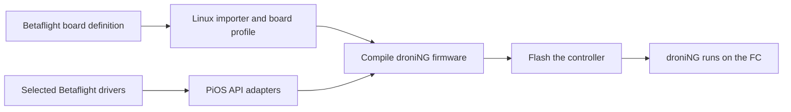

# Firmware support and Betaflight driver integration plan

Detailed implementation proposal, updated 2026-10-10. Hardware availability
checked on 2026-10-09. The [Betaflight source survey and offline driver proof](flight/PiOS/Betaflight/README.md)
now exist; proposed production adapter files and commands below remain to be
implemented. Hardware validation remains to be done.

Expand droniNG hardware support by importing Betaflight board definitions and
compiling selected Betaflight peripheral drivers against PiOS. The Linux build
and installer perform the adaptation; the resulting droniNG firmware runs on
the flight controller. droniNG supplies the flight algorithms, scheduling,
settings and USB telemetry. An existing Betaflight binary cannot be converted
into this firmware at installation time.

New supported STM32 profiles boot the application directly from flash and use
ST's built-in ROM DFU for installation, updates and recovery. The existing
Revolution/custom-bootloader layout remains supported during migration. The
[boot strategy](#boot-strategy-stm32-rom-dfu-for-new-supported-profiles) and
milestones below cover the firmware, GCS and settings changes together.

Retain purchasable legacy board families while developing this route to current
hardware. Retire narrow targets with discontinued hardware or no verified sale,
subject to the proposed decisions below. Target deletions and adapter
implementation are subsequent work.

## Current targets and hardware availability

The build registers 17 embedded targets: 14 flight controllers and three
auxiliary devices. `flightd` is a separate Linux target. The inventory comes from
[target definitions](flight/targets/) and the [top-level Makefile](Makefile).
The README alone omits some registered targets.

**Orderable** means a seller lists assembled hardware as in stock or available
to add to a cart. It does not establish continued manufacture, checkout success
or delivery to a particular country. **Unconfirmed** means no current orderable
assembled board was verified; it is not proof of discontinuation. Bare PCBs,
accessories, historical listings and different processor variants do not count.

| Target | Processor | Hardware coverage and sale evidence | Proposed disposition |
| --- | --- | --- | --- |
| `aq32` | STM32F407 | AeroQuad32. Current assembled-board sale unconfirmed; the [AeroQuad project](https://github.com/AeroQuad/AeroQuad) is no longer actively maintained. | Retire unless an owner will maintain and test it. |
| `brain` | STM32F405 | Original BrainFPV is explicitly listed under [discontinued products](https://www.brainfpv.com/support/). No current stock verified. | Retire. |
| `brainre1` | STM32F446 | BrainFPV RE1 is also listed under [discontinued products](https://www.brainfpv.com/support/). No current stock verified. | Retire. |
| `dtfc` | STM32F303 | DTFc itself is [out of stock](https://www.getfpv.com/dtfc-flight-controller.html). The target also covers Colibri Race / TBS PowerCube; a [PowerCube V2 package containing a Colibri F3 V2 controller](https://www.aerial-shop.com/fr/electronique/247-tbs-powercube-4-en-1-20a-v2.html) lists remaining stock. | Retain as legacy family support; verify purchased Colibri revisions. |
| `lux` | STM32F303 | README supports Lux V1 only. [GetFPV marks V1 discontinued](https://www.getfpv.com/lumenier-lux-flight-controller.html). [HEBU lists an F3 Lux board in stock](https://www.hebu-shop.ch/shop/lux-flight-controller-32-bit-f3-prozessor/), but its exact revision and pin compatibility are unverified. | Hold the decision. Retain if that board matches V1; otherwise retire unless an owner maintains it. |
| `matek405` | STM32F405 | Source identifies the old F405-CTR hardware. [Matek marks CTR end of life](https://www.mateksys.com/?portfolio=f405-ctr). Current stock of an exact supported variant is unconfirmed. Newer Matek F405 boards require their own profiles. | Retain temporarily as an integration reference, then replace the handwritten target with validated imported profiles. |
| `omnibusf3` | STM32F303 | Original Omnibus F3 is [discontinued at Rotorama](https://www.rotorama.com/product/omnibus-f3). Rotorgeeks lists an [F3 controller using Betaflight's OMNIBUS target in stock](https://rotorgeeks.com/mini-f3-flight-controller-w-bec-and-osd). | Retain legacy family coverage; confirm clone wiring. |
| `pikoblx` | STM32F303 | PikoBLX and clones. [FlexRC lists a 20 mm Piko BLX clone in stock](https://flexrc.com/product/piko-blx-micro-flight-controller-clone/). Piko F4 products are different hardware. | Retain as legacy support. |
| `quanton` | STM32F405 | Quanton plus original TBS Colibri / Gemini, as documented in the README. Current assembled-board sale unconfirmed for both families. Original Colibri is distinct from Colibri Race. | Retire both supported families unless an owner maintains them. |
| `revolution` | STM32F405 | Revolution, mini/clone variants, and existing Omnibus F4 adaptations. [HEBU lists Revolution and mini Revolution stock](https://www.hebu-shop.ch/produkt-kategorie/rc-modellbau/rc-modelle/rc-drohnen-fpv-rc-modelle/fpv-zubehoer/flugkontroller-fpv-zubehoer/kontroller-flugkontroller-fpv-zubehoer/). Airbot lists [Omnibus Fireworks V2 in stock](https://store.myairbot.com/flight-controller/omnibusfireworksv2.html), but that exact revision needs compatibility validation. | Retain. Document exact supported revisions instead of promising all Omnibus F4 boards. |
| `seppuku` | STM32F405 | DTFAir Seppuku. Current assembled-board sale unconfirmed. | Retire unless an owner maintains it. |
| `sparky` | STM32F303 | Original Sparky revision 2, distinct from Sparky2. [HEBU lists Sparky 1.0 V2 in stock](https://www.hebu-shop.ch/shop/sparky-flight-controller-1-0-v2-cc3d-upgrade/). | Retain as legacy support. |
| `sparky2` | STM32F405 | Sparky2 plus Brushed Sparky revisions handled by the source. [HobbyKing marks Sparky2 discontinued](https://hobbyking.com/taulabs-sparky-2-0-32bit-flight-controller.html); [WowDrone lists it sold out](https://wowdrone.kr/product/taulabs-sparky20-f4-flight-controller/593/). Current assembled Brushed Sparky sale unconfirmed. | Retire unless an owner maintains either variant. |
| `sprf3e` | STM32F303 | SP Racing F3 EVO and FrSky XSRF3E. The [manufacturer lists EVO out of stock](https://shop.seriouslypro.com/sp-racing-f3-evo); [Rotorama marks XSRF3E discontinued](https://www.rotorama.com/product/frsky-xsrf3e). Brushed EVO and Femto listings do not establish compatibility with this target. | Retire unless an exact compatible, orderable variant or active owner is established. |
| `pipxtreme` | STM32F103 | PipXtreme / OPLink radio modem, not a flight controller. [AMOV lists OPLink hardware in stock](https://amovrobotlab.com/products/openpilot-oplink-cc3d-tx-rx-frsky-remote-controller-transmitter-transmitters). | Retain separately as auxiliary radio support. |
| `playuavosd` | STM32F405 | Standalone PlayUAV OSD. Current orderable stock unconfirmed; the [historical retail listing](https://moshobby.ru/magazin-2/product/playuav-osd-playuavosd-on-screen-display-apm-pixhawk-px4-flight-control-support-for-fpv) does not establish current inventory. | Retire from the maintained auxiliary targets. |
| `flyingpio` | STM32F030 | FlyingPi I/O expander for a Linux host. Current assembled-board sale unconfirmed. `flightd` includes its host driver. | Propose retirement after checking the `flightd` dependency and whether the hardware is still used. |
| `flightd` | Native / Linux | Linux-hosted flight software, built separately through `FLIGHTD_BOARDS`; no single board purchase applies. | Retain pending a build and utility review. Separate useful host testing from obsolete FlyingPi hardware support. |

Family coverage above is supported by the [README](README.md), board source and
GCS definitions. In particular, [SP Racing's GCS description](ground/gcs/src/plugins/boards_droning/sprf3e.cpp)
names XSRF3E; [Sparky2's board header](flight/targets/sparky2/board-info/pios_board.h)
names Brushed Sparky revisions; and [Revolution settings](shared/uavobjectdefinition/hwrevolution.xml)
contain Omnibus F4 and F4 V2 options. These facts do not establish compatibility
with every later revision bearing those brands.

## Proposed target decisions

Remove `aq32`, `brain`, `brainre1`, `quanton`, `seppuku`, `sparky2` and `sprf3e`
from maintained flight-controller builds. Remove `playuavosd` from maintained
auxiliary builds. These are proposals for the user to approve before deletion;
an actively tested board owned by the user is a reason to retain its target.

Retain `revolution`, `dtfc`, `omnibusf3`, `pikoblx` and `sparky`. Preserve
`matek405` until the generated-board route has a validated replacement. Resolve
Lux's revision before deciding its fate. Assess `flyingpio` together with its
host dependency; keep `pipxtreme` and `flightd` separate from the FC list.

Treat retained F3 targets as legacy: fixes and existing functions, with feature
growth bounded by measured flash and RAM. The build already excludes `sparky`,
`sprf3e`, `pikoblx` and `omnibusf3` from debug builds because they overflow.
Purchasable clearance stock supports keeping a target useful, but does not make
it the foundation for future hardware support.

Deletion must cover build registration, bootloader images, GCS board entries,
packaged firmware and target-specific settings. Shared PiOS drivers, radio
support and flight algorithms require a remaining-user check before removal.
Keep existing board IDs reserved and document retired hardware in release
notes. Linux desktop support does not depend on retaining a particular FC.

## Adaptation design and intended result

The deliverable is a reusable route from an upstream Betaflight hardware
definition to a board-specific droniNG firmware image. A new board using an
already supported processor and peripherals should normally require a profile,
documented wiring overrides and hardware validation, rather than another copy
of board initialization and a bespoke GCS plugin.

There are three separate compatibility problems:

| Problem | Where it is solved | Result |
| --- | --- | --- |
| Board wiring and fitted components | Python importer and code generator on Linux | Native PiOS configuration tables, build inputs and GCS hardware metadata. |
| An unsupported peripheral, such as a newer IMU | Selected Betaflight chip source, a C port and a small PiOS compatibility API | A device driver compiled into the FC image. |
| Installing onto a board currently running Betaflight | Linux installer with STM32 ROM DFU support | A direct-boot application for new STM32 profiles, or the complete bootloader/application image required by a supported legacy layout. |

The FC runs droniNG stabilization, estimator, scheduler, settings and USB
telemetry. Compilation resolves the board configuration and unused features;
the hardware driver and necessary adapter still execute on the FC. This design
does not translate a Betaflight `.hex` binary or import its PID implementation.

Provide prebuilt images for validated profiles as the normal installation path.
Expose local compilation for development and selected feature combinations.
Installing a supported board should not require every user to install an ARM
compiler, obtain Betaflight sources or depend on Betaflight's cloud build.

### First release scope

Start with STM32F405, one IMU, four verified motor outputs, one receiver port,
native droniNG USB, watchdog and persistent settings. **OSD, telemetry and GPS
are required capabilities for accepted imported-board support. Autotune is
strongly preferred and planned for the reference builds.** Add battery
measurements, additional UART roles and flight logging as individually validated
capabilities. Use the existing PiOS implementations for supported parts; use the
driver adapter first for ICM42688-P.

| Capability | Priority and acceptance requirement |
| --- | --- |
| OSD | Required. Initially use the surveyed boards' MAX7456-compatible analog OSD with CharacterOSD. Verify video/font output and live flight/GPS data. A digital OSD requires its own implemented and validated protocol/backend. Confirm the fitted OSD hardware on the exact reference revision. |
| Telemetry | Required. Provide native USB/UAVTalk GCS telemetry and a validated external telemetry path for the documented configuration. Receiver-link telemetry may share its UART when the selected protocol supports it; otherwise reserve a separate port. Specify protocol, direction/duplex and reported flight/GPS data. |
| GPS | Required. Reserve a usable UART for an external GPS, include the GPS module and expose configuration, fix/satellite status, position/velocity and stale/lost-data status in GCS, OSD and telemetry. Validate actual GPS reception and simultaneous receiver/telemetry operation. Navigation modes also need their required estimator/sensors and separate flight evidence. |
| Autotune | Strongly preferred. Include the existing module in reference builds and budget its acquisition buffers, CPU load and tune-data storage. Validate collection, transfer to GCS, tuning workflow and persistence. Record a specific limitation if a profile cannot support it; omission must not be silently presented as full-featured support. |

A profile lacking implemented, build-enabled and validated OSD, telemetry or
GPS remains experimental until those required capabilities pass. A successful
basic-flight bring-up is an intermediate milestone. Required board support does
not mean every flight mode depends on a GPS fix: runtime arming checks follow
the selected mode's actual sensor requirements. Do not disable a required
feature merely to make a profile fit its firmware layout or resource budget.

F3 boards remain legacy targets. F7, H7, G4, AT32 and other processors need
separate processor support; F411 also needs explicit startup, memory and
peripheral support beyond the initial F405 build. Dual IMUs, bidirectional
DShot/RPM telemetry, software serial, external-clock IMUs, external-memory
boot images and arbitrary Betaflight
resource remapping are later work. Recognizing their configuration macros must
produce a clear unsupported result or an explicitly disabled optional feature.
It must not imply that those functions work.

Target retirement is independent of this implementation. The deletion list
above remains a proposal; deleting old targets is not a prerequisite for
building the adapter.

### Reference hardware and expansion hardware

**Reference: HGLRC F4 V6PRO.** During inspection its current USB
descriptors reported `Betaflight`, `OmnibusF4`, and VID/PID `0483:5740`.
A read-only host serial query on 2026-10-10 confirmed `MSP_FC_VARIANT=BTFL`,
firmware **Betaflight 3.2.3**, MSP API **1.36**, and board identifier **OBF4**.
The evidence is saved in `build/qt612-release/serial-firmware-probe.log`.
The installed Betaflight target agrees with the manufacturer's firmware instructions.

The [manufacturer's manual](https://cdn.shopify.com/s/files/1/2672/8290/files/HGLRC_F4V6PRO-manual.pdf?9860837140640360721=)
specifies STM32F405RGT6, MPU6000, OSD and flash storage, and identifies the
historical Betaflight firmware target as `OMNIBUSF4`. It assigns SBUS to UART1,
IRC Tramp to UART3 TX and ESC telemetry to UART6 RX. Its storage label is not a
substitute for reading the fitted chip's JEDEC capacity.

The existing [Revolution initialization](flight/targets/revolution/fw/pios_board.c)
already handles modified clones, missing original sensors and MAX7456 OSD.
[Revolution hardware settings](shared/uavobjectdefinition/hwrevolution.xml)
contain explicit Omnibus LED pin alternatives. These provide the hardware backend
for this board.

**Initial catalog mapping:** HGLRC F4 V6PRO uses the existing `revolution`
target, packaged as the full-install `ef_revolution.hex` and application update
`fw_revolution.tlfw`. The compatibility check compares the manufacturer's board
specification and immutable Betaflight 3.2.3 definitions with the actual Revolution
pin tables and initialization. The MCU, MPU6000 SPI/interrupt wiring, OSD and flash
bus, four motor outputs, UARTs, SBUS inverter, ADC and USB resources agree.
The [checked hardware profile](shared/firmware/compatibility/hglrc-f4-v6pro.json)
records the source commit and file hashes. Upstream
[release notes](https://github.com/d-ronin/dRonin/releases/tag/Release-20180212.2)
also describe Omnibus F4 clone support through the Revolution target.
The catalog recommends Revolution for HGLRC F4 V6PRO and configures it during
first installation: `AttitudeSettings.BoardRotation.Yaw = -9000` (−90°),
`HwRevolution.SPIPeripheral = MAX7456 OSD`, and `Magnetometer = None`.
The yaw correction accounts for OMNIBUSF4's CW180 versus REVO's CW270 sensor
orientation in Betaflight's common coordinate convention. The regression check
executes the current PiOS MPU transform and rotation math with independent axis
vectors. Motor 3's PA3 uses TIM9 CH2 in PiOS rather than TIM2 CH4; both are valid
STM32F405 alternate functions for the same pad.

The Qt 6 Linux release includes the Revolution bootloader/application, full
installation binary/HEX and build-derived validation manifest. The installer
validates the image, verifies the written bytes, checks the running descriptor
and flight data, applies each profile settings object, saves and reloads it from
flash, checks the retained values, and restarts the controller. Completion requires
fresh flight data and the matching descriptor after that restart. Unknown board
models receive an explicit no-candidate result. Additional exact board mappings
will reuse this source comparison and installation-profile mechanism.

**Expansion candidate: GEPRC Taker F405 BLS 60A V2 / GEP-F405-HD V3.**
[Rotorama lists the stack](https://www.rotorama.com/product/geprc-taker-f405-bls-60a-v2-stack),
and [GEPRC identifies the controller](https://geprc.com/product/geprc-taker-f405-bls-60a-v2-stack/)
as F405 with ICM42688-P, BMP280 and Betaflight target `GEPRCF405`.
Hardware acquisition and exact revision confirmation are dependencies for its
bench and flight validation; this candidate is not yet supported.

The [upstream GEPRCF405 configuration](https://github.com/betaflight/config/blob/master/configs/GEPR/GEPRCF405/config.h)
allows several IMUs and barometers. Its wiring differs from Revolution: for
example, the gyro is on SPI3, with PA15 chip select and PC3 data-ready interrupt.
This makes it a useful proof that the generator handles different wiring rather
than reproducing a Revolution clone. Lock the first profile to the actual fitted
parts, with any supported substitutions listed explicitly.

### Market hardware support priorities

Prioritize this broader hardware shortlist, reviewed on 2026-10-10, including
boards outside the current droniNG catalog and HDZero stacks/AIOs. It reflects
common DIY choices and factory-fitted controller families,
not an audited sales ranking. Prioritize families with a substantial installed
base as well as current products; confirm availability of the exact revision
before buying reference hardware. For example, SpeedyBee's listings mark the
[F405 V5](https://www.speedybee.com/speedybee-f405-v5-55a-stack/)
and [F405 AIO V2](https://www.speedybee.com/speedybee-f405-aio-v2-35-40a-bluejay-25-5x25-5-3-6s-flight-controller/)
as discontinued, so their family priority is not a claim of current production.

Use this implementation order after the HGLRC reference and GEPRC expansion
milestones. These are future support priorities, not accepted support entries:

1. **P1: mainstream F405 coverage.** Start with SpeedyBee F405 regular/Mini,
   then Mamba F405 and F405 AIO profiles from SpeedyBee and Flywoo. The GEPRC
   F405 reference remains the first expansion case. Reuse the F405 backend,
   common initializer and proven drivers; record any new IMU, clock or storage
   dependency separately.
2. **P2: F7, H7, G4 and AT32 coverage, including HDZero.** Port processor
   backends as separate projects, with F722/F745, H743 and G4 ahead of the
   iFlight ATF435 variant. Target the regular and AIO families below as each
   backend becomes available. HDZero Halo, Gamma and AIO15 are explicit
   priorities, with MSP DisplayPort digital OSD and serial ELRS integration.
3. **P3: constrained F411 and SPI-receiver AIOs.** Cover older whoop variants
   and HDZero AIO5 after their processor/resource and onboard-radio requirements
   are resolved. Reserve receiver, GPS, telemetry and digital-OSD resources
   before accepting a profile; small size does not waive required capabilities.

Within each priority, select an exact obtainable revision with documentation
and bench hardware. A profile with a missing dependency stays experimental;
independent profiles in the same priority can progress while it is resolved.

**Regular controllers and FC + separate four-in-one ESC stacks:**

| Priority | Controller families to support | Betaflight definition examples and implementation focus |
| --- | --- | --- |
| P1 | SpeedyBee F405 V3/V4/V5 and F405 Mini | `SPEEDYBEEF405V3`, `SPEEDYBEEF405V4`, `SPEEDYBEEF405V5`, `SPEEDYBEEF405MINI`. Start with an obtainable revision; validate fitted IMU, external clock requirements and storage rather than treating revisions as interchangeable. |
| P1 / P2 | Diatone Mamba F405/F722, Mini variants, and Mamba H743 | `MAMBAF405_2022A`, `MAMBAF405_2022B`, `MAMBAF722`, `MAMBAH743`. F405 first; F722/H743 follow their processor ports. Match the exact generation and Mini wiring. |
| P1 / P2 | GEPRC GEP-F405-HD / TAKER F405 and GEP-F722 / TAKER F722 | `GEPRCF405`, `GEPRCF722`. Extend the initial GEPRC reference by exact revision, then add F722; verify IMU/barometer substitutions. |
| P2 | iFlight BLITZ F7 / Mini F7, F745 and ATF435 | `IFLIGHT_BLITZ_F722`, `IFLIGHT_BLITZ_F7_PRO`, `IFLIGHT_BLITZ_F435`. Confirm the SKU-to-target mapping; F7 and AT32 variants need their respective processor support. |
| P2 | Holybro Kakute H7 / H7 Mini | `KAKUTEH7`, `KAKUTEH7V2`, `KAKUTEH7MINI`. H7 backend plus exact-revision sensor and peripheral validation. |
| P2 | HDZero Halo / Halo Mini / Halo Stack | [`HDZERO_HALO`](https://github.com/betaflight/config/blob/master/configs/HDZO/HDZERO_HALO/config.h). H743, onboard Gemini serial ELRS and digital OSD; verify receiver UART and fitted IMU. The Halo Stack adds a separate 70A four-in-one ESC; the VTX is separate. |

**AIO controllers, with ESCs on the controller PCB:**

| Priority | Controller families to support | Betaflight definition examples and implementation focus |
| --- | --- | --- |
| P1 | SpeedyBee F405 AIO / AIO V2 | `SPEEDYBEEF405AIO`, `SPEEDYBEEF405AIOV2`. F405 reuse with AIO-specific motor/current/power and port validation. |
| P1 / P2 | Flywoo GOKU F405 AIO / GN745 AIO | `FLYWOOF405S_AIO`, `FLYWOOF745AIO`, `FLYWOOF745AIOV2`. F405 first, then F745; select the matching physical revision. |
| P2 | GEPRC GEP-F722-45A AIO V2 / TAKER F722 35A–45A | `GEPRC_F722_AIO` is a family example. Confirm the target, current rating and wiring for each SKU; require F722 processor support. |
| P2 / P3 | BETAFPV Air and Matrix 1S, especially Matrix 5IN1 II | `BETAFPVG473`, `BETAFPVG473_V2`, `BETAFPVG473_V3` are G4 examples. Prioritize Matrix G4 variants, then constrained older variants; verify the actual MCU/gyro, serial versus SPI ELRS, VTX type and available UARTs. |
| P2 / P3 | Happymodel SuperX, CrazybeeG473, X12/X14 | `CRAZYBEE473`, `CRAZYBEEF405`, `CRAZYBEEF4SX1280` are family examples. Match each model/revision's MCU, radio and gyro; G4 coverage and SPI-radio support are separate dependencies. |
| P2 / P3 | HGLRC Specter F411/F722 AIO | `HGLRCF411`, `HGLRCF722AIO`, `HGLRCF722AIOV2`. F722 follows P2 processor support; constrained F411 variants follow P3. |
| P2 | HDZero Gamma 45A AIO | [`HDZERO_GAMMA`](https://github.com/betaflight/config/blob/master/configs/HDZO/HDZERO_GAMMA/config.h). G4, 3–6S, AM32 ESCs and onboard serial ELRS; digital OSD requires an external VTX. |
| P2 | HDZero AIO15 | [`HDZERO_AIO15`](https://github.com/betaflight/config/blob/master/configs/HDZO/HDZERO_AIO15/config.h). G4, 2–3S, 15A ESCs, serial ELRS and integrated HDZero VTX; verify simultaneous receiver/GPS/telemetry/OSD operation. |
| P3 | HDZero AIO5 | [`CRAZYBEEF4SX1280`](https://github.com/betaflight/config/blob/master/configs/HAMO/CRAZYBEEF4SX1280/config.h). F411, 1S, 5A ESCs, SPI ELRS and integrated HDZero VTX; use [HDZero's revision-specific configuration](https://docs.hd-zero.com/aio5-firmware) for the fitted BMI270 or ICM42688. |

The market review found relevant definitions for all these families in the
[current Betaflight configuration repository](https://github.com/betaflight/config/tree/master/configs).
The names above are lookup examples, not a guarantee that one target covers
every SKU or revision, or that every definition is available in a selected
Betaflight release. Before importing a profile, pin its exact configuration and
firmware sources, verify the fitted parts and resource map, and pass droniNG's
own bench/flight gates. Betaflight support does not establish droniNG support.

HDZero hardware details come from the manufacturer pages for
[Halo Stack](https://www.hd-zero.com/product-page/hdzero-halo-stack),
[Halo Mini](https://www.hd-zero.com/product-page/hdzero-halo-mini-flight-controller),
[Gamma](https://www.hd-zero.com/product-page/hdzero-gamma-45a-hd-ready-aio),
[AIO5](https://www.hd-zero.com/product-page/hdzero-aio5) and
[AIO15](https://www.hd-zero.com/product-page/hdzero-aio15).
Halo and Gamma have no analog OSD chip; implement and validate MSP DisplayPort
with an actual HDZero VTX/goggle setup. Integrated serial ELRS requires the
receiver's serial protocol/backend; SPI ELRS additionally needs an onboard-radio
implementation, not just an imported pin map. Replacing the FC firmware does
not replace separate ESC, serial-receiver or VTX firmware. Track those versions,
control interfaces and compatibility in the exact-board validation record.

### Existing code that constrains the design

| Existing code | Consequence for implementation |
| --- | --- |
| [Target registration](Makefile) and [Revolution target definition](flight/targets/revolution/target-defs.mk) | The build discovers one-level target directories. Nested imported profiles need an explicit registration mechanism. |
| [Architecture selection](make/firmware-arches.mk) and [Revolution firmware Makefile](flight/targets/revolution/fw/Makefile) | F405 already has startup, STM32 peripheral and ChibiOS support. Importing board wiring does not create a new processor backend. |
| [Common firmware build](make/firmware-common.mk) | Object names currently use source basenames. Imported drivers and compatibility headers must avoid collisions or gain path-aware object naming. |
| [PiOS SPI API](flight/PiOS/inc/pios_spi.h) | The adapter can use existing bus claims, clock selection, chip selects and transfers; their timing and error semantics still need validation. |
| [PiOS sensor API](flight/PiOS/inc/pios_sensors.h) and [MPU driver](flight/PiOS/Common/pios_mpu.c) | Imported IMUs must publish samples through PiOS callbacks or queues and report rates, scales and errors. |
| [Firmware descriptor](make/templates/firmwareinfotemplate.c) and [FirmwareIAPObj](shared/uavobjectdefinition/firmwareiapobj.xml) | The descriptor is 100 bytes, with 12 reserved bytes in the actual struct. Board type is only eight bits; it cannot serve as the complete profile identity. |
| [Board information structure](flight/PiOS/inc/pios_board_info.h) and [bootloader transfer protocol](flight/targets/bl/common/bl_messages.h) | Application offsets, partition sizes and identity checks must agree in firmware, bootloader, package and uploader. |
| [GCS board interface](ground/gcs/src/plugins/coreplugin/iboardtype.h) | Current capabilities and output banks are supplied by board classes. A shared imported-board class needs generated and runtime metadata. |
| [GCS uploader](ground/gcs/src/plugins/uploader/uploadergadgetwidget.cpp) and [transfer implementation](ground/gcs/src/plugins/uploader/tl_dfu.cpp) | These use the droniNG/Tau Labs bootloader protocol, not STM32 ROM DFU. First installation needs another backend. |
| [Entire-flash packaging](flight/targets/EntireFlash/Makefile) | Its bootloader, padding and duplicate descriptors are checked by the installation-bundle generator and runtime image validator. Builds honor `BUILD_DIR`. The legacy command-line `dfu` recipe runs without elevation; the GCS installer supplies the additional device and readback checks. |

The current Revolution configuration uses 168 MHz, 128 KiB ordinary SRAM and
64 KiB CCM. Its firmware partition is 384 KiB, independently of the physical
chip's larger capacity. Preserve that layout for the reference comparison.
The [partition setup](flight/targets/revolution/board-info/board_hw_defs.c)
calls [capacity adjustment](flight/PiOS/Common/pios_flash.c) to expand logging
on larger external flash chips; there is no fixed 2 MiB logging-device limit
implied by the initial table.

### Architecture

Betaflight now describes boards through its [config repository](https://github.com/betaflight/config),
using `config.h` and sometimes `config.c` or `config.mk`. Import the hardware
information and selected driver source from pinned compatible revisions of that
repository and [Betaflight firmware](https://github.com/betaflight/betaflight).



The importer and compilation run on Linux, potentially when the user requests
installation. Driver register operations and any necessary PiOS adapter code
execute on the FC. Direct calls and inlining can keep this small; actual CPU
and memory costs must be measured. Compiling in advance does not eliminate
the need to implement the hardware behavior on the controller.

### Proposed source and output locations

Keep shared hardware descriptions outside individual flight targets so the
firmware build, GCS and installer consume the same information. The following
paths are proposed; existing files are extended only at their integration points.

| Location | Responsibility |
| --- | --- |
| `shared/boardprofiles/schema.json` | Versioned normalized profile format and field constraints. |
| `shared/boardprofiles/profiles/<id>.json` | Reviewed hardware profile for an exact board/revision or verified set of equivalent revisions. |
| `shared/boardprofiles/overrides/<id>.json` | Missing hardware facts, translated quirks and reasons for each override. |
| `shared/boardprofiles/upstream.lock.json` | Exact upstream commits, input paths/hashes, dependency files, licenses and recorded local changes. |
| `shared/boardprofiles/catalog.json` | Profile names, pictures/pad labels, supported revisions, release support levels and known limitations. |
| `make/scripts/board_import/` | Python 3 extraction, normalization, validation, generation and reporting tools. |
| `make/imported-boards.mk` | Explicit imported-profile build rules and dependencies. |
| `flight/targets/imported/` | Shared F405 firmware that boots directly from flash, with generated board tables, metadata and STM32 ROM-entry support. |
| `flight/PiOS/Betaflight/upstream/` | Selected upstream chip source and required headers, with their original notices. |
| `flight/PiOS/Betaflight/compat/` | Small, documented bus/time/device API compatibility surface. |
| `flight/PiOS/Betaflight/ports/` | PiOS sensor wrappers and reviewed driver adaptations, traceable to upstream source. |
| `shared/uavobjectdefinition/hwimported.xml` | Shared imported-board settings, with stable port/output indices. |
| `shared/uavobjectdefinition/boardprofile.xml` | Read-only full profile identity, layout version and actual detected capabilities. |
| `ground/gcs/src/plugins/boards_imported/` | One imported-board implementation and profile-driven hardware configuration UI. |
| `ground/gcs/src/plugins/uploader/` | Image manifest checks, existing bootloader update backend and new ROM DFU backend. |
| `tests/board_import/` | Pinned profile fixtures, expected resource maps and invalid-profile cases. |
| `build/imported/<build-key>/` | Generated C, headers, linker/Make inputs, ELF/map files, firmware images and manifest. |

Do not check generated build directories into the source tree. Check in the
normalized profiles, overrides, locks, fixtures and generator source. Package
the exact generated results and source inputs with releases so a user can
inspect or rebuild the image without reconstructing an old upstream branch.

### Upstream inputs and version policy

Use two independently pinned upstream inputs: Betaflight firmware for chip
drivers and MCU timer/DMA information, and Betaflight config for contemporary
board definitions. The [config repository documentation](https://github.com/betaflight/config)
describes `config.h` and optional `config.c`/`config.mk`. Older boards such as
the HGLRC reference may need historical `target.h`, `target.c` and build
definitions rather than a current config entry.

Select an exact firmware/config commit pair after checking the first driver's
dependency closure and the chosen profile's macro meanings. Record full commit
IDs and file hashes before implementation starts using those inputs. This plan
has inspected upstream source but has not selected or vendored that pair;
links to `master` here are evidence references, not reproducible build pins.

Implement current `config.h` as the first automated input format. Normalize the
HGLRC historical definition into a reviewed reference fixture; a general parser
for every historical target format is not a first-release requirement. A later
legacy frontend can emit the same normalized schema without changing the
firmware or GCS backend.

The importer records original macro/value, file and source location for each
derived fact. Overrides record the replacement, reason and supporting source
or hardware measurement. An upstream update produces a reviewable profile and
dependency diff. Existing release profiles stay pinned until that diff is
accepted and affected hardware is retested. Never track upstream `master`
automatically during a user's installation.

### Compatibility catalog seeded from Betaflight

**Initial implementation (2026-10-10):**
[`shared/firmware/board-catalog.json`](shared/firmware/board-catalog.json) is the
versioned catalog embedded in the GCS. It contains all **17** direct mappings
from this repository's `ALL_BOARDS` targets and one explicit retail-board
mapping, **HGLRC F4 V6PRO → Revolution**. The direct records include the
FlyingPIO, PipXtreme/TauLink and PlayUAVOSD peripherals; the POSIX simulator is
excluded. Board type/revision values refer to the firmware descriptor, not an
inferred physical PCB revision. Native records cite their board-info files;
the HGLRC record cites the checked hardware profile and supplies installation settings.

The Core firmware resolver validates the schema, names, target references and
descriptor identities. It resolves application, bootloader-update and full
installation artifacts separately, in packaged firmware directories or build
output. A mapping does not imply that an image exists or that its contents are
validated. It never substitutes an application-only image for an installation
image. Existing uploader image lookup uses this same resolver.

The Firmware tab owns board detection, connection guidance, firmware selection,
BOOT instructions, installation progress and results. Connecting a controller
automatically selects this tab. Startup opens Welcome; the initial device inventory
does not change workspaces. A new controller attachment after discovery or an
explicit Connect action selects Firmware.
Welcome provides **Connect controller** when USB setup is complete, or **Open controller**
when connected. The legacy global connection selector is removed; telemetry and alarm
indicators remain available in the flight workspaces. The disconnected Firmware page
presents a live controller selector and **Connect controller**. USB guidance changes
immediately between plugging in a controller and connecting the detected device.
Discovery filters built-in serial ports, generic USB serial adapters and unrelated peripherals;
it includes native controller interfaces, STM32 CDC devices and USB products identifying
flight-controller firmware or a catalog model. When HID and serial interfaces share a USB
topology, the selector presents the native HID interface once. Discovery preserves the
selected controller as devices come and go. Compatibility resolution still uses the
protocol identity and reviewed catalog records.
Connection is the default journey, with bounded cards for board, firmware and bootloader
information. Native flight data opens **Tune & configure**, **Flight data** and **Live graphs**
as available in the current workspace profile. No installation wizard or BOOT-mode prompt
appears during normal connection. Installation is offered when foreign firmware or STM32
BOOT mode is detected, or explicitly selected under **Maintenance & recovery**.
Installation guides BOOT entry, writes and readback, restart and verified flight data;
completion offers aircraft configuration and Flight data. Connection controls live on
this page. The firmware workflow uses the full tab,
retaining saved gadget layouts while hiding auxiliary instruments in the Firmware
workspace. Recovery commands and expandable diagnostics remain inline.
**Maintenance & recovery** preserves recovery through
an existing dRonin USB bootloader, firmware files and partition operations. Native
bootloader discovery opens those tools automatically. The STM32 BOOT installer is the
primary first-installation and ROM recovery flow.
An installed dRonin controller answering on an MSP port receives inline guidance
to select its UAVTalk interface until flight data connects.

Detection activity appears immediately,
and a bounded read-only MSP probe starts after a short native-handshake grace
period instead of waiting eight seconds. Confirmed MSP firmware stops futile
UAVTalk requests; unknown connections continue retrying and report that state.
The board selector and text use bounded, readable widths. Connection and firmware states render inline;
there are no catalog, handshake-error, installer or upgrade-assistant popups.
The read-only diagnostic probe
queries `MSP_BOARD_INFO` as well as API/firmware identity. Historical `OBF4` and
full target `OMNIBUSF4` suggest the HGLRC entry. The board model selector handles
shared identifiers and manual selection. Shared identifiers return all matching entries;
unknown identifiers remain unknown, and a user can select an exact known model
manually. Neither the USB product `OmnibusF4` nor an F405 processor alone selects
Revolution. Missing or invalid images disable installation with a visible reason.
Rescue routes a confirmed foreign-firmware connection to this tab. A native
rescue timeout also selects it. Read-only DFU discovery detects a controller
already in STM32 BOOT mode and selects Firmware automatically. The detected
firmware includes the MSP version. Bootloader type can come from a reviewed
hardware profile: the HGLRC STM32F405 entry identifies **STM32 system bootloader
(USB DFU)** even while Betaflight runs. Bootloader versions appear only when
reported; no version is derived from the Betaflight version. Unknown hardware
without a bootloader record remains **Not reported** on an MSP connection.
The installation action starts the bundled Linux ROM DFU workflow described below.

**Future work: expand the catalog.** Import and review more Betaflight boards
using the stages below. Add exact model/revision aliases, resource comparisons,
required hardware settings, limitations and bench/flight evidence; distinguish
stock-target mappings from boards needing adaptation. Keep ambiguous identifiers
as multiple candidates. Extend the implemented image manifests and Linux DFU
workflow to additional reviewed targets. The initial catalog does not claim
compatibility for the rest of the Betaflight inventory.

To check the feature in the rebuilt GCS, connect the board. Firmware opens with
the detected board, firmware and bootloader state. Select **HGLRC F4 V6PRO**
if it was not identified. **Install DroniNG** authorizes
replacing firmware/settings, closes the serial transport and renders
BOOT-button/pad instructions in the tab.
Reconnect in the same USB port while
holding BOOT; release BOOT once connected. After DFU discovery and geometry
checks, installation starts automatically without another click.
The screen shows write/readback/boot/reconnect progress and device errors. With
the reference board connected on its Betaflight port, the same tab shows
Betaflight's version and the HGLRC candidate from the read-only `OBF4` reply.
Detection and selecting a model do not change
controller settings or firmware.

Validation uses the Qt 6.12 build exclusively. The connection diagnostic suite
covers 79 cases. Tests compare every native catalog record with
its source target/type/revision, exercise HGLRC and unknown/ambiguous identifiers,
reject malformed mappings, separate installation/update image availability and
exercise controller filtering, dynamic USB guidance, styled popup lists, hot-plug selection, native USB interface preference,
stable USB identity across repeated and reordered scans, preservation of active connections,
immediate identification progress, inline connection recovery and flight-data loss
and recovery. The application UI check exercises the delivered package's connection
page, Welcome connection CTA, removal of the global selector, connection-first layout,
full-width Firmware workspace, expanded popup styling, compact board selection, validated install
action, inline BOOT instructions, diagnostics and cancellation. Logs are in
`build/qt612-release/connection-first-connection-tests.log` and
`build/qt612-release/connection-first-ui-tests.log`; rendered previews are in
`build/qt612-release/connection-first-ui`. Installer and packaging evidence is
recorded below.

Use Betaflight's board definitions as the hardware inventory, with a separate
droniNG compatibility record for each reviewed board/revision. The pinned
`betaflight/config` survey commit
`e1d87e7ecf6717bd3806a08400aeb892cd1d1fc3` contains **632** `config.h`
definitions, confirmed from its complete Git tree on 2026-10-10. These include
`AIRB/OMNIBUSF4`, its named variants, and `OPEN/REVO`. The inventory is useful
for recognition even when a board has no droniNG image. Betaflight's own
supported-target marking must not become a droniNG support claim.

Expand the catalog in these stages:

1. Fetch a pinned config snapshot and the matching firmware context, preserving
   upstream files, licenses, hashes and source paths. Include historical target
   definitions when needed for older identifiers such as `OBF4`; do not infer
   that a similarly named contemporary board is the same hardware.
2. Normalize manufacturer/board names, MCU, clocks, allowed sensor alternatives,
   bus wiring, orientation, outputs, UARTs and peripherals. Use the preprocessing
   and timer-resolution approach already exercised by the six-board survey.
   Required information that is missing, conditional or supplied by custom code
   remains an explicit review item.
3. Compare each normalized board against the existing Revolution configuration
   and its supported settings. Produce per-resource matches, differences and
   unsupported requirements. Classify an incomplete comparison as unknown;
   a plausible mapping becomes a candidate. A differing required pin map or
   unavailable device/backend requires adaptation rather than the stock image.
4. Maintain a reviewed droniNG record containing exact retail model/revision,
   historical detection aliases, target, required settings, limitations and
   source/hardware evidence. An upstream target can cover several retail boards
   or component substitutions, so do not equate its name with one exact PCB.
5. Attach the compatible release's full-install image manifest and verification
   records. Promote the exact tested configuration to supported after its bench
   checks. Publish the versioned catalog with the Linux application and images;
   review upstream changes before updating existing compatibility records.

The comparison can already identify useful matches: at this pin, Betaflight's
`AIRB/OMNIBUSF4` describes the gyro on SPI1 with PA4 chip select, and motor
outputs 1–4 on PB0/PB1/PA3/PA2. These match the corresponding resources in
the existing Revolution hardware tables. This is evidence for a candidate,
not a completed whole-board comparison or validation. Normalize orientation
semantics and compare the remaining clocks, interrupts, UARTs, flash, OSD,
electrical behavior and required settings before accepting the stock image.

The catalog exposes both recognition and installation results: supported image
available, candidate needing confirmation, adaptation required, or unknown.
Image availability is checked separately. A recognized upstream board with no
compatible artifact must produce a clear explanation in Rescue rather than an
automatic Revolution selection.

### Normalized board profile contract

Use JSON with a versioned schema and explicit units. Separate stable hardware
facts from user configuration and selected build features. The importer must
not present Betaflight tuning defaults as hardware requirements.

| Group | Required information and validation |
| --- | --- |
| Identity | Stable profile ID; manufacturer/model; actual PCB revisions; aliases with evidence; upstream target and exact input provenance. An alias is not permission to assume identical wiring. |
| Processor | Exact supported part/package, clock source/frequency, ordinary SRAM/CCM regions, physical flash and erase geometry. Reject a processor without a droniNG backend. |
| Flash layout | Boot strategy, application/reset-vector/descriptor/settings/extension regions, external storage geometry, layout ID/version and erase boundaries. New supported STM32 profiles use ROM DFU and an application starting at `0x08000000`; legacy custom-loader layouts remain explicitly versioned. All generated consumers must agree; no overlaps or out-of-chip ranges. |
| GPIO | Pin, electrical polarity, pull, startup state, alternate function and feature owner. Include sensor power enables and receiver inverter control pins. |
| Buses | SPI/I2C instance, pin assignments and allowed speeds; each device's chip select/address and transaction requirements. |
| IMU | Allowed fitted models, bus, chip select, DRDY pin/edge, orientation matrix, supported sample rates/ranges and backend selection. Unexpected or absent required IMU prevents arming. |
| Other peripherals | Required OSD backend and actual fitted hardware; barometer, magnetometer, flash, SD, LEDs and buzzer with explicit status/backends. Include navigation sensor dependencies and autotune storage requirements. |
| UARTs | MCU UART, TX/RX pins, physical pad labels, inverter hardware, supported direction/duplex and available droniNG roles. Reserve a simultaneous receiver, GPS and external telemetry configuration; record permitted sharing. Distinguish a UART from a software-serial resource. |
| Outputs | Physical pad and stable output index; timer/channel/alternate function; any DMA mapping; supported PWM/DShot modes and shared timer constraints. Preserve intended motor numbering. |
| Inputs and ADC | Receiver/PPM/RSSI resources; ADC pin/channel; board voltage-divider and current-sensor calibration, expressed in droniNG units with conversions documented. |
| Resource alternatives | Mutually exclusive pin, timer, EXTI and DMA uses, plus tested feature combinations. Validate enabled combinations instead of rejecting every alternative assignment. |
| Build selection | Enabled drivers/modules and fixed wiring choices. Require OSD, GPS and the chosen telemetry modules in accepted builds; plan autotune support. Include explicit optional feature exclusions and compiled capacity limits. |
| Capabilities | Hardware fitted, backend implemented, build enabled and runtime detected are separate states. Support level applies to a documented tested configuration. |
| Validation | Reference image/config, bench record, timing/memory report, tested revision and flight record where one exists. A successful compile is not a validation record. |

For example, a board may expose a pin as both motor output and LED strip. A
profile can describe both alternatives; the build/settings validator must reject
enabling both together. IMU orientation is applied once in the sensor wrapper;
the user's airframe mounting rotation remains a separate existing setting.

Use one canonical serialization of normalized hardware and layout to derive a
full SHA-256 profile fingerprint. Keep a separate build key covering feature
selection, droniNG source, upstream locks, generator/adapter source and toolchain.
A compiler update must not make a physically identical board acquire a new
hardware identity. A changed pin map or incompatible layout must.

### Import, validation and generation pipeline

1. **Load pinned inputs.** Resolve the selected upstream files and overrides,
   verify hashes and list neighboring configuration files. No network is needed
   once those source inputs are present.
2. **Resolve the preprocessing context.** Use the pinned C preprocessor with
   declared processor/feature defines and an audited set of upstream defaults.
   Capture macro definitions and expand known structured macros into typed
   records. Preserve conditionals/provenance in the import report. A regex-only
   scan cannot resolve included defaults or conditional wiring reliably.
3. **Classify every input.** Hardware macro, deliberately ignored tuning/default
   macro, or unsupported construct. Maintain explicit lists. An unknown item
   that may affect required hardware fails import with its file, macro and
   reason; it is not silently ignored.
4. **Handle custom code deliberately.** Do not execute `config.mk` or compile
   arbitrary `config.c` as part of extraction. Translate necessary power-rail,
   inverter or boot quirks into reviewed named hooks and profile fields. A
   board depending on an untranslated hook remains unsupported.
5. **Normalize wiring.** Convert pin names, bus identities, orientations,
   polarities and ADC calibration into droniNG semantics. Fitted sensor
   alternatives remain explicit rather than assuming every `USE_*` sensor is
   present simultaneously.
6. **Resolve timer/DMA choices.** Interpret `TIMER_PIN_MAPPING` with the matching
   pinned upstream MCU tables. Emit actual timer/channel/alternate-function/DMA
   assignments, not Betaflight table indices. Validate them against the selected
   PiOS motor backend and the exact MCU pin/interrupt definitions.
7. **Validate resources and layout.** Check pin availability, bus/device support,
   mutually exclusive roles, shared timer rates, DMA/EXTI conflicts, memory
   regions, erase boundaries, feature dependencies and image size limits for
   the declared boot strategy.
8. **Produce the reviewed profile.** Write normalized JSON and a report of
   imported facts, overrides, ignored settings, unresolved items and feature
   limitations. Only a profile with resolved required facts can generate a
   flashable image.
9. **Generate native build inputs.** Emit `board-info.mk`, `pios_board.h`,
   `pios_config.h`, hardware tables, `memory.ld`, selected source/module lists,
   ROM-entry/flash-layout metadata and GCS resource metadata into the build
   directory. Put a source/profile hash in generated headers for diagnosis.
10. **Compile and package.** Run existing ARM/ChibiOS/PiOS build stages through
    the shared imported-target skeleton. Validate the ELF, image segments,
    descriptor and manifest against the profile before marking an image
    installable.

Diagnostics should explain the action needed, for example: a required oscillator
frequency is missing; a motor and ADC request the same DMA stream in the selected
configuration; a sensor-power hook is untranslated; or an F722 profile has no
supported processor backend. Never fall back to a Revolution pin map merely
because a profile says STM32F405.

### Build integration and generated initialization

Add explicit `fw_imported` and `ef_imported` entry points with a
required `BOARD_PROFILE`. Leave legacy `ALL_BOARDS` builds functional. Do not add
a profile-less pseudo-board to that list and break `all_fw`; imported release
builds iterate an explicit validated catalog.

Proposed developer entry points, once implemented:

```bash
make board_import BOARD_PROFILE=hglrc_f4v6pro
make board_validate BOARD_PROFILE=hglrc_f4v6pro
make fw_imported BOARD_PROFILE=hglrc_f4v6pro
make ef_imported BOARD_PROFILE=hglrc_f4v6pro
```

Extend the existing build templates so generated board roots and selected
source lists can be passed without assuming `flight/targets/<board>`. Isolate
generated-profile outputs and shared libraries by toolchain/ABI and relevant
inputs; one profile must not accidentally reuse another profile's tables or a
stale common UAVObject library. Detect duplicate source basenames immediately,
then use namespaced/path-aware object names where imported source needs them.

The shared initializer uses generated tables and a small enum of supported
device backends. Its startup sequence establishes inactive chip selects and
disabled motor outputs, clocks, power/inverter hooks, buses, storage/settings,
USB, sensors, required OSD/GPS/telemetry services, selected receiver roles and
watchdog. Sensor failures and missing resources enter the existing fault/arming
path according to the selected flight mode. Report required-capability failures
explicitly; optional-device failures are reported as absent capabilities.

For the HGLRC comparison, keep the native PiOS MPU6000 driver and the legacy
Revolution memory layout. Match known working wiring and selected functions;
the generated binary need not be byte-identical to the legacy binary. For GEPRC,
use a separately verified layout and wiring profile. Reuse named quirks only
where hardware needs them; each new board should not acquire another large
board-specific initialization function.

### C driver compatibility boundary

Import only a reviewed chip driver's dependency closure. The first driver is
Betaflight's [ICM426xx implementation](https://github.com/betaflight/betaflight/blob/master/src/main/drivers/accgyro/accgyro_spi_icm426xx.c).
Inspection shows it calls SPI/time services and shared MPU read/init helpers;
it also references gyro configuration and, in an optional external-clock path,
global gyro state. It is not an independent source file that can simply be added
to the PiOS build unchanged.

Use a combination of small API shims for low-level services and a recorded port
of chip-specific code where upstream directly accesses Betaflight configuration
or shared acquisition internals. Preserve register initialization and relevant
hardware fixes. Replace global configuration reads with explicit PiOS device
configuration. Implement acquisition through PiOS, or import only demonstrably
small needed helpers. Do not bring in Betaflight's gyro-processing module,
parameter-group system or scheduler to satisfy those calls.

For every reused driver, maintain an inventory of source files, required
headers/types/functions, local adaptations, enabled code paths and upstream
hardware fixes. Compile its adapter against mock bus/time services before
linking it into flight firmware. Check undefined symbols and the final link map
against an allowed dependency list. If the dependency set grows into Betaflight
application code, revise the port boundary instead of widening the shim without
review.

| Service or contract | Adapter behavior |
| --- | --- |
| SPI device | Map a configured device to its PiOS bus and chip-select index; define mode and initialization/runtime speed explicitly. |
| SPI transaction | Claim the bus, apply device speed/mode, select CS, transfer, deselect and release on every exit path. Serialize banked-register sequences where required. Bound bus wait and transfer time. |
| Read/write failures | Propagate errors through the wrapper, including a per-device failure state where an upstream function has no error return. Do not publish fabricated samples from failed transfers. |
| GPIO | Use generated electrical configuration and named ownership; do not let a imported chip driver claim arbitrary motor/receiver pins. |
| Delay and time | Separate startup delays from acquisition timing; use a defined monotonic time unit and wrap-safe comparisons. Blocking delays are not permitted in ISR acquisition paths. |
| Data-ready interrupt | Register through PiOS EXTI, capture readiness/time and notify the acquisition context with ISR-safe operations. Bound work in the interrupt handler. |
| Sensor configuration | Pass device model, range, output rate and hardware filter choice explicitly. Betaflight software filters and PID settings do not enter this interface. |
| Samples | Decode a coherent gyro/accelerometer frame, apply scale and orientation once, then deliver through PiOS callbacks/queues. Track frame freshness and per-consumer use internally. |
| Missing/stale data | Respect requested wait times, report failures and expose diagnostics. Required sensor failure enters the existing control/arming fault path. |
| DMA, when added | Preserve completion/error and buffer-lifetime semantics; allocate buffers in DMA-accessible SRAM and validate resource assignments. Do not make an asynchronous API secretly synchronous. |

The initial ICM42688-P port supports one SPI-connected device, internal sensor
clock and a documented rate/filter combination. Use a proposed 1 kHz baseline
for the initial timing comparison; confirm compatibility with droniNG's actual
control-loop configuration before fixing that profile default. Start with
bounded transfers and DRDY-driven acquisition. Add asynchronous/DMA operation
only if measurements require it or a separately declared feature needs it.
Do not claim 8 kHz control operation merely because a sensor supports that rate.

Gyroscope output must be degrees per second, acceleration metres per second
squared and temperature degrees Celsius. Register the actual sample rate and
gyro range with PiOS. Test six static orientations, known angular motion,
axis signs, range/scale changes, sample pairing, timeout behavior and reset.
Do not silently change the common sensor structure or inject another software
rotation/filter stage into the existing estimator.

Retain source copyright/license notices and include the corresponding source,
local modifications and build inputs with distributed firmware. Document the
origin of generated profiles and translated tables as well as imported C code.

### Peripheral support choices

| Peripheral | First implementation | Additional work and evidence needed |
| --- | --- | --- |
| MPU6000 | Existing PiOS driver on HGLRC. | Generated wiring must reproduce the working baseline. Importing another MPU6000 driver is unnecessary for the first milestone. |
| ICM42688-P | Port selected Betaflight chip code through the new boundary. | Register/scale/filter tests, real DRDY acquisition and GEPRC hardware validation. |
| SPI/I2C/UART/ADC | Existing STM32F405 PiOS backends with generated configuration. | Check alternate functions, inversion, ADC conversions and shared resources on each physical board. |
| Motor outputs | Existing PiOS servo/PWM and supported DShot backend. | Verify output numbering, timer constraints and actual waveforms. Betaflight DMA maps need translation; they do not prove that PiOS supports the same mode. |
| MAX7456 OSD (required) | Existing PiOS device driver and CharacterOSD module. | Verify fitted hardware, wiring, video/font operation, live flight/GPS data and bus contention with the gyro or flash. |
| MSP DisplayPort digital OSD (required for digital profiles) | Planned UART protocol/backend using droniNG flight/GPS state, after the initial analog reference. | Required for HDZero priorities. Verify actual VTX/goggle rendering, font/resolution, warnings, reconnect behavior and concurrent receiver/GPS/telemetry load. No digital support is implied by an analog OSD driver or board definition. |
| GPS (required) | Existing GPS module and supported NMEA/UBX paths over an imported UART. | Verify protocol/configuration, fix/position/velocity, GCS/OSD/telemetry data and loss/staleness behavior. Navigation needs separately verified estimator/sensor prerequisites. |
| Telemetry (required) | Native USB/UAVTalk plus an existing supported external telemetry backend for the chosen configuration. | Validate live flight/GPS data, link behavior and simultaneous receiver/GPS operation; document any shared UART. |
| Autotune (strongly preferred) | Existing Autotune module and GCS tuning workflow. | Allocate buffers and tune-data storage, verify data collection/transfer/persistence and measure timing under required-feature load. |
| Logging flash | Existing JEDEC/storage support where compatible. | Read actual geometry, validate erase commands and settings/log partition separation; add an adapted chip driver only if needed. |
| BMP280 | Existing PiOS driver where fitted. | Validate the profile's bus/address and actual fitted barometer; do not substitute DPS310 automatically. |
| HGLRC IRC Tramp control | Separate subsequent driver integration. | Current VTXConfig source exposes SmartAudio; a board profile alone cannot implement Tramp. Verify protocol/UART electrical behavior and add the GCS role/settings deliberately. |
| Other receivers and ESC telemetry | Existing protocols only where implemented and validated. | Expose supported protocols by port. New protocols require their own adapter/backend and tests. |
| Integrated ELRS receivers | Validate serial ELRS through the required receiver protocol/backend; treat SPI ELRS as separate radio integration work. | Record receiver type, UART or SPI/IRQ wiring, firmware compatibility, binding, command/telemetry operation and loss/failsafe behavior. Verify shared-resource constraints on AIOs and Halo's Gemini receiver. |

Motor, receiver and optional-device wiring must be validated independently of
the IMU port. A working gyro does not establish that a controller can safely
drive its motors or receive commands.

### Memory, resource and timing budgets

Generate one authoritative memory layout for the application, reset vectors,
descriptor, settings and package. The current HGLRC installation uses the legacy
Revolution 384 KiB application region and custom bootloader. The generated
STM32 ROM-only profile moves the application to `0x08000000` through the explicit
migration below. Define its usable application space from the actual flash
geometry and reserved data regions, with coordinated firmware/installer changes
and handling of existing settings/extensions.

Report `.text`/`.rodata`, initialized data, ordinary SRAM, CCM, static allocation,
heap reservation and measured stack/heap margins. Include runtime driver state,
queues and transfer buffers, not just object-file size. F405 DMA buffers must use
accessible ordinary SRAM: CCM is CPU-only, as described in
[ST's reference manual](https://www.st.com/resource/en/reference_manual/rm0090-stm32f407-advanced-armbased-32bit-mcus-stmicroelectronics.pdf).

Use an otherwise equivalent native-driver build as the comparison when
measuring adapter cost. Record acquisition time, IRQ-to-sample latency, sample
loss/staleness, stabilization/actuator deadline misses and CPU load under
concurrent receiver, GPS, USB/external telemetry and OSD activity, plus enabled
logging and autotune acquisition. For an initial 1 kHz setup,
the period is 1 ms; set a measured timing/headroom limit before accepting it,
rather than assuming average CPU load establishes the deadline.

The baseline audit also checks [Brain's linker script](flight/targets/brain/fw/memory.ld),
which declares 1024 KiB after a 128 KiB offset, against its 896 KiB firmware-bank
metadata if that target is retained. Matek405's 384 KiB application limit needs
the same partition review before expansion. Preserve unrelated legacy layouts
until a coordinated migration is implemented.

### Firmware identity and GCS integration

Reserve an unused imported-board family ID after auditing the existing board-ID
registry; never recycle a retired board ID. Use the full profile fingerprint and
layout ID for exact identity. Shared USB IDs, `OMNIBUSF4` or a common F405 part
number cannot establish PCB wiring.

Proposed descriptor extension: use the existing 12 reserved bytes for a four-byte
`NGP1` marker and an eight-byte prefix of the hardware-profile SHA-256. Keep the
100-byte descriptor and existing fields in their original positions. The prefix
is a compatibility identifier, not a cryptographic authenticity mechanism.
Store the full fingerprint and layout version in the manifest and expose them
through a new read-only `BoardProfile` UAVObject. Update descriptor generation,
GCS parsing and ROM DFU installer together; test old-descriptor behavior.

Store board/profile/layout identity in the application image and expose it through
`BoardProfile` while firmware runs. Before an update, capture that identity and
bind the DFU device through its USB topology and available serial information.
Read and compare stored metadata through ROM DFU when the layout is known and
readback is available. An erased or damaged application requires exact board
selection: ST's bootloader reports MCU/memory information, not PCB wiring or a
droniNG profile. Shared USB IDs must not select an imported image automatically.

Use one imported-board GCS class plus `HwImported` settings for supported port
roles, output modes, required OSD/GPS/telemetry and optional features. Show
autotune availability and any specific limitation. Generate labels and capabilities from
the shared profile/catalog. Show actual pad names such as UART1 rather than
forcing every board into Revolution's Main/Flexi/Rx connector names. Use bounded
port/output arrays with explicit unused entries; keep their ABI and persisted
settings versioned.

At connection, reconcile manifest/catalog expectations with the firmware's full
identity and runtime detected devices. The UI enables only supported roles and
rejects conflicting pin/timer combinations. Firmware must independently validate
settings and prevent unsupported combinations from reaching the hardware.
New profiles should not need a new hardware UAVObject or hand-written GCS class.

### Linux installation, updates and recovery

#### Boot strategy: STM32 ROM DFU for new supported profiles

New supported STM32 profiles use the processor's built-in system bootloader for
installation, updates and recovery. They do not install a separate droniNG
bootloader. This is the planned architecture, not the current Revolution image
format. Other processor families need their own documented boot strategy.

Each profile declares the exact MCU's ROM transport, USB pins and hardware-entry
procedure from its reference documentation and board wiring. ROM USB DFU
support is a profile acceptance requirement for this backend. A processor or
board without that transport needs a separately implemented boot strategy.

The STM32F405 in the HGLRC reference provides USB DFU in system ROM, programmed
by ST during manufacture. Betaflight Configurator uses that bootloader; it is
not a Betaflight bootloader. ST documents the MCU-specific entry conditions in
[AN2606](https://www.st.com/resource/en/application_note/an2606-stm32-microcontroller-system-memory-boot-mode-stmicroelectronics.pdf)
and memory erase/write/readback operations in
[AN3156](https://www.st.com/resource/en/application_note/an3156-usb-dfu-protocol-used-in-the-stm32-bootloader-stmicroelectronics.pdf).
The GCS already contains a bundled `dfu-util` backend with device binding and
byte-for-byte readback verification, which this architecture reuses.

The existing custom bootloader provides board identity, partition operations,
transfer checking, safe-start requests and application startup. Its
[startup code](flight/targets/bl/common/main.c) jumps to the firmware offset
declared in board information; its [transfer code](flight/targets/bl/common/bl_xfer.c)
also accesses external storage. These services must move to the application and
GCS as follows:

1. **Direct firmware boot.** Generate linker/startup inputs with reset vectors at
   `0x08000000` and correct interrupt-vector placement. Embed board information
   inside the application instead of reading the legacy bootloader's
   `pios_board_info_blob` region. Generate descriptor and partition metadata from
   the same layout, and remove dependencies on custom-loader version/capabilities.
2. **Software entry into ROM DFU.** Add a disarmed firmware command that stops
   actuator output, records a boot request and resets. Handle that request early
   in startup, before the RTOS or peripherals run, using the MCU-specific ROM
   address, memory mapping, stack/vector setup and interrupt/clock requirements.
   Clear the request before entry. BOOT-button/pad entry remains available when
   the application is damaged or cannot communicate.
3. **Host image and update checks.** Validate the selected board/profile, stored
   identity when available, layout, image ranges and hashes in the GCS. Bind the
   returning DFU device to the selected controller, erase only declared sectors,
   read back the written image and require correct identity plus fresh telemetry
   after boot. ST's ROM loader does not supply droniNG board or partition semantics.
4. **Settings and safe start.** Preserve compatible settings on ordinary updates
   and implement reset-to-default/safe-start requests in the application. Back up
   external SPI-flash settings through running firmware before migration. ROM DFU
   cannot directly read or restore that external flash; recovery from broken
   firmware must first restore a compatible application, then access its storage.
5. **Legacy migration.** Keep the current Revolution/custom-loader artifacts and
   native HID backend available for existing installations. Package conversion
   to ROM-only boot as an explicit layout migration, including settings/schema
   handling and a declared return image. An application-only Revolution image
   linked at `0x08020000` cannot substitute for a direct-boot image.

The acceptance gate covers cold power-on, reset, software and hardware ROM entry,
install/update/readback, USB re-enumeration, settings persistence/default reset,
and recovery after interrupted writes or an invalid application. Firmware must
boot after power removal without a GCS or a one-time DFU jump. Check that motor
outputs remain inactive through ROM entry and recovery.

The Firmware tab presents **Install DroniNG** and uses one
detection/install/update/recovery flow. Reported firmware appears with the board;
bootloader information appears alongside it in the installation comparison. The current
full image installs the dRonin bootloader and firmware. ROM-only profiles must
use their corresponding direct-boot image after implementation and validation.

#### Betaflight flashing source inspection (2026-10-10)

The existing GCS Rescue workflow detects the droniNG/Tau Labs USB HID
bootloader; it does not discover or communicate with STM32 ROM DFU. First
installation must be part of this Linux product's Rescue workflow. Requiring
Betaflight Configurator to install droniNG leaves that workflow incomplete.

Inspected Betaflight Configurator **10.10.0**, pinned to commit
`c97deaf7146837b2378e683a7f5b429fea34d5a9`, and the current
[USB DFU implementation](https://github.com/betaflight/betaflight-configurator/blob/master/src/js/protocols/usbdfu.js).
The desktop source was downloaded to `/tmp/droning-betaflight-configurator-10.10.0`.
These source findings informed the implemented Linux installer below.

| Step | Inspected source | Behavior relevant to droniNG |
| --- | --- | --- |
| Load local image | [firmware_flasher.js](https://github.com/betaflight/betaflight-configurator/blob/c97deaf7146837b2378e683a7f5b429fea34d5a9/src/js/tabs/firmware_flasher.js#L696), [hex_parser.js](https://github.com/betaflight/betaflight-configurator/blob/c97deaf7146837b2378e683a7f5b429fea34d5a9/src/js/workers/hex_parser.js) | Parses Intel HEX into addressed byte ranges. The DFU writer uses these ranges; it does not convert the image to Betaflight or require Betaflight flight algorithms. |
| Enter boot mode | [stm32.js](https://github.com/betaflight/betaflight-configurator/blob/c97deaf7146837b2378e683a7f5b429fea34d5a9/src/js/protocols/stm32.js#L156) | Queries MSP API version. Below API 1.42 it sends legacy ASCII `R`; newer versions use an MSP reboot destination selected from board capabilities. Then it closes serial and waits for a DFU device. Hardware boot entry remains the recovery route. |
| Inspect flash | [stm32usbdfu.js](https://github.com/betaflight/betaflight-configurator/blob/c97deaf7146837b2378e683a7f5b429fea34d5a9/src/js/protocols/stm32usbdfu.js#L625) | Reads DfuSe memory-layout strings and the DFU transfer-size descriptor; checks image ranges against writable flash. STM32 ROM DFU is a USB control-transfer protocol, separate from the existing HID bootloader. |
| Erase and write | [stm32usbdfu.js](https://github.com/betaflight/betaflight-configurator/blob/c97deaf7146837b2378e683a7f5b429fea34d5a9/src/js/protocols/stm32usbdfu.js#L839) | Selects affected pages or all pages, uses DfuSe erase/address commands and DFU DNLOAD blocks, and polls GETSTATUS using the device's reported delay. |
| Verify and boot | [stm32usbdfu.js](https://github.com/betaflight/betaflight-configurator/blob/c97deaf7146837b2378e683a7f5b429fea34d5a9/src/js/protocols/stm32usbdfu.js#L1029) | Reads written ranges back with UPLOAD, compares bytes, then leaves DFU using the image's first address. droniNG must additionally wait for its own USB interface and a successful UAVTalk connection. |

The connected board reports MSP API **1.36**. Betaflight firmware **v3.2.3**,
commit `cb962eda1a1aa7575cf36001a8ad080c96a5d9fd`, confirms that
[serial.c](https://github.com/betaflight/betaflight/blob/cb962eda1a1aa7575cf36001a8ad080c96a5d9fd/src/main/io/serial.c#L502)
handles the configured reboot character by entering the bootloader; its default
is `R`. This supports a version-aware shortcut for this installation, with
hardware boot instructions if the character was changed or software entry fails.
No reboot command was sent to the physical board during this inspection.

The full-image format already exists: `make ef_revolution` builds
`ef_revolution.hex` through the [EntireFlash Makefile](flight/targets/EntireFlash/Makefile).
It includes the bootloader at `0x08000000`, padding, the application at
`0x08020000`, and firmware descriptors according to the existing Revolution
layout. A synthetic 512 KiB image generated through the same binary-to-Intel-HEX
conversion was parsed by the unmodified Betaflight 10.10.0 parser. All bytes and
addresses matched, including the eight 64 KiB address blocks; a corrupted data
checksum was rejected. The parser check verifies the addressed full-image format;
the current Linux release packages the compiled Revolution installation image
and its build-derived validation manifest described below.

Integrate first installation independently of the new board-profile importer:
the initial Rescue backend can accept an existing validated legacy full image
for a supported board. Imported profiles add their manifest and identity checks
later. Both paths must validate the selected board and image before erasing.
ROM DFU's shared USB ID cannot select an Omnibus PCB variant automatically.

Keep a single Qt workflow for device selection, boot instructions, installation
progress, diagnostics, verification and reconnect. A bundled `dfu-util` can
provide the native Linux DFU transport initially; a C++ libusb implementation
can provide the same operations directly. Neither route needs Betaflight
Configurator or a manually installed external flasher. If porting Betaflight
code, retain its GPL and copyright notices and replace its Chrome/WebUSB and UI
calls with the Qt/backend interface. The command-line `ef_*_dfu` target now runs
unprivileged, but remains a raw developer transfer command without the GCS's
image/device/readback checks and must not be used as its process runner.

The inspected Betaflight backend also contains read-unprotect handling.
Normal Rescue installation must report protected flash explicitly and must not
automatically send the destructive unprotect command or modify option bytes.
Tests must cover malformed/out-of-range/overlapping image records, ambiguous
devices, permission errors, timeouts, disconnects, failed writes/readback and
post-flash firmware identity, before real hardware installation.

#### Resetting the reference board for UI tests

[`make/scripts/restore-board.py`](make/scripts/restore-board.py) returns the HGLRC
F4 V6PRO to its original **Betaflight 3.2.3 / OMNIBUSF4** firmware so connection,
foreign-firmware detection and DroniNG installation can be tested repeatedly.
The original version, API and target come from the saved read-only MSP probe.
The utility restores the official release with clean settings. The factory
STM32 ROM bootloader remains available throughout; replacing flash at
`0x08000000` removes the dRonin bootloader.

Run from the repository root:

```bash
# Download/cache and validate the pinned official image; no board operations.
python3 make/scripts/restore-board.py

# Close DroniNG, then start the reset and follow its BOOT instructions.
python3 make/scripts/restore-board.py --flash

# Confirm firmware identity after an ordinary USB reconnect; no flashing.
python3 make/scripts/restore-board.py --check
```

The BOOT procedure is: disconnect USB and the flight battery, hold the BOOT
button beside the USB socket, reconnect USB to the same port, then release BOOT.
After successful reset, open DroniNG and exercise the connection/installation
workflow again.

The utility uses Python's standard library and the bundled dfu-util 0.11.
`make firmware_installer_runtime` builds that helper if absent. It selects the
controller's USB topology before the BOOT transition and waits for its ROM DFU
interface. Multiple controllers require an explicit `--usb-path`, such as
`--usb-path 3-1.4.3.4`; every transfer also selects DFU configuration, interface,
alternate and serial number. An unknown or incompatible flash layout stops the
reset before any erase.

[`shared/firmware/test-restores.json`](shared/firmware/test-restores.json) pins
the official release URL, asset ID, HEX length/hash, decoded full-flash hash,
MCU flash geometry and expected MSP identity. Intel HEX checksums, bounds,
overlaps, stack and executable reset vectors are checked before opening DFU.
The image fills the entire 1 MiB internal flash, with unused space set to
`0xff`; dfu-util erases all declared sectors and writes the clean image.
This resets Betaflight configuration as well as firmware. ROM, option bytes
and external SPI flash are outside the reset. No unprotect command is sent.

Each run gets a dated directory under `build/firmware-restore/`, containing:

- `before.bin`: a complete internal-flash backup, checked and saved before erase.
- `restore.bin` and `readback.bin`: the expected image and complete verification readback.
- `restore.log` and `result.json`: command output, stages, USB selection, hashes and post-boot identity.

The controller is rechecked after backup. It leaves DFU only after every
readback byte matches, then the script checks `BTFL`, version `3.2.3`, board
`OBF4` and API `1.36` on the same USB port using read-only MSP requests. If BOOT
exit needs a manual reconnect, release BOOT, unplug/reconnect USB and use
`--check`; the verified flash does not need another write. Access failures
provide the package's copyable USB-rule installation command.

The cached HEX is reused on subsequent runs. `--image /path/to/betaflight_3.2.3_OMNIBUSF4.hex`
accepts an offline copy with the same checksum; `--dfu-util /path/to/package/bin/dfu-util`
selects another packaged helper, and `--output /path/to/results` changes the
cache/backup location. Additional reference boards can be added to the test
restore catalog with their recorded original firmware, official image pins,
geometry, BOOT procedure and post-boot identity.

Regression checks run without real USB or flash access:

```bash
python3 ground/tests/restore_board.py
```

They exercise the real subprocess interface with a simulated DFU helper and
the serial protocol through a pseudo-terminal: complete reset/backup/readback,
checksum/vector/bounds failures, ambiguous or changed devices, wrong flash
geometry, incomplete backup, permission errors, disconnect/write failure,
readback mismatch, timeouts and mismatched post-boot identities. The default
preparation command is also checked to perform no DFU operations.

#### Installer implementation

The initial Linux installation workflow is implemented (2026-10-10):

- `make/firmware-installer.mk` builds pinned dfu-util **0.11** and shared libusb
  **1.0.29**, checking upstream archive SHA-256 values before extraction.
  Linux `make gcs` includes `firmware_install_bundle` by default; set
  `WITH_FIRMWARE_INSTALLER=NO` for a desktop-only developer build. Install the
  pinned ARM SDK once with `make arm_sdk_install` when building flight images.
  `FIRMWARE_INSTALL_TARGETS` defaults to `revolution`; additional reviewed native
  targets can use the same generator/backend. Missing images stay unavailable.
- `make/scripts/firmware-install-bundle.py` checks full-image/application hashes,
  the duplicate 100-byte descriptors, bootloader board-info and the current
  UAVObject definitions. It bundles binary/HEX/update artifacts and a manifest
  derived from the target's declared layout. Entire-flash builds now honor
  `BUILD_DIR`. The packaged installer has a relative library search path and
  ships both upstream source archives, license notices and checksum provenance.
- Core validates manifest schema, board target/type/revision, bounds, SHA-256,
  executable vectors (including STM32 CCM stack RAM), bootloader layout,
  application SHA-1 and descriptor/UAVObject identity before enabling preparation.
  It transfers a private snapshot of the checked bytes.
- `DfuInstaller` uses a replaceable command-runner interface and structured
  process arguments. The sequence is explicit Install action → image validation
  → BOOT/DFU discovery → fresh device check → bounded write → full readback
  byte comparison → one-byte upload with `:leave` → telemetry verification.
  Discovery refuses multiple internal-flash DFU devices; transfers select the
  exact USB topology, configuration/interface/alternate and available DFU serial.
  The reported DfuSe layout must cover the full image with read/erase/write
  permissions and aligned erase boundaries. It never uses force, mass-erase,
  read-unprotect or option-byte writes.
- Serial/HID enumeration records Linux USB topology. Installation releases the
  old serial connection and suspends normal polling during transfers. Reconnect
  selects the running native USB interface on the same physical port, with
  ordinary autoconnect suppressed during the installation. Success requires the
  exact installed firmware descriptor and fresh `AttitudeActual` data from the
  new UAVTalk connection. After readback, the tab shows that firmware is installed
  and verified while it waits for live data. If no connection appears after five
  seconds, it automatically attempts to start the installed controller; **Start
  controller** also offers this action directly. STM32 DFU uses the one-byte
  `:leave` command. The DroniNG bootloader uses `BL_MSG_JUMP_FW` after checking
  the USB port, board type/revision and exact installed firmware descriptor.
  These start operations do not erase or write firmware. A failed start keeps
  the verified installation and reconnect actions available. Native bootloader
  communication runs in a cancellable worker so the page stays responsive.
  The tab also provides the full power-cycle step: disconnect USB and the flight
  battery, then reconnect USB to the same port with BOOT released. After a minute
  it replaces the busy indicator with a waiting message and keeps watching for
  the controller, so a later reconnection still completes the workflow.
  The existing native bootloader updater remains
  the path for later application-only updates.

Hardware BOOT-button/pad entry is the supported initial route across installed
firmware versions. The optional version-aware Betaflight software-reboot shortcut,
Betaflight configuration export and a larger compatibility catalog remain future
work. Board-specific settings are applied and verified as part of first installation.
HGLRC F4 V6PRO receives its orientation, OSD and magnetometer configuration before
the installer reports completion.

Connecting a DroniNG controller keeps the Firmware page focused on its current
state. Firmware maintenance stays collapsed until requested. After settings have
been retrieved, controllers with no configured actuator outputs show “Set up
controller?” with a short introduction and a “Launch setup wizard” action in the
existing controller card. Configured controllers offer tuning and live data.
The same setup offer is available from Welcome and after installation. The wizard
opens only on an explicit action, preserves the current workspace, and closes
without an automatic-launch suppression prompt. Changes to actuator settings
refresh the offer; disconnecting clears it before another controller connects.

Product firmware versions come from `shared/product-version.json`; the initial
release is **DroniNG 1.0**. The firmware descriptor and installation overview use
that release name. Git revision, branch and working-tree changes remain separate
build metadata. The old `next-dirty` label combined a development branch name
with the presence of uncommitted tracked changes anywhere in the repository,
including the GCS. Flight-control sources and UAVObject definitions match the
base commit; installer changes select the correct build directory and assemble
the bootloader, firmware and descriptors. Changing the release label preserves
the firmware and bootloader executable hashes. An already installed image with
the old label is identified as the product release only when its board,
commit, executable hash and UAVObject hash match the verified bundled image.
Other dRonin versions retain their own reported identities.

Connection readiness survives initial object retrieval. Completing a request
disconnects only its transaction callback, preserving live attitude and flight
statistics subscriptions. Retrieval completion preserves identity and live data
already received after the handshake. Regression checks exercise the actual
UAVTalk parser with both early and requested attitude data, subsequent live
packets, and telemetry loss. Connection checks are recorded in
`build/qt612-release/product-version-connection-tests.log`. A controller that
finishes retrieval without live attitude data receives an inline explanation
after eight seconds; later data automatically clears it. Version and image
checks are recorded in
`build/qt612-release/product-version-tests.log` and
`build/qt612-release/product-version-installation-tests.log`; the independent
firmware build is recorded in
`build/qt612-release/product-firmware-source-audit.log`.

Software tests simulate device responses and file transfers; they do not write
controller firmware. The Qt 6 release includes the actual Revolution image, and
All 62 cases in `ground/tests/firmware_installation.cpp` pass on Qt 6.12.0,
including validation of the bundled image.
The start/progress verification is recorded in
`build/qt612-release/firmware-start-installation-tests.log`. These tests check that the bundled image validates
against the GCS, plus malformed images, protected/undersized flash,
ambiguous/changed/disappearing devices, access errors, unavailable Linux USB,
write/readback/boot failures,
cancel, continued DFU discovery from the boot guidance state, USB access-rule
command quoting, permission recovery and post-flash identity. They also check
phase-labelled progress, read-only DFU start retries, changed bootloader rejection,
native bootloader identity checks and cancellation before the jump command.

The Firmware tab keeps hardware BOOT instructions visible during
discovery failures and shows them once. A controller connected in its normal USB
firmware mode enters `NeedsBoot`: the tab explains that bootloader mode is not
active in the log. The page keeps the current BOOT steps and an active progress
indicator visible. It continues
watching the selected USB port and installs automatically when STM32 DFU appears.
Discovery timeout also directs the user to the manual's bootloader procedure.
Catalog records can supply verified board-specific BOOT instructions and a
manufacturer manual link. The HGLRC entry identifies the BOOT button beside USB,
requires disconnecting USB and the flight battery before entry, and links the
manufacturer's F4 V6PRO manual. Other entries currently show generic instructions
to locate BOOT and follow the board manual's USB bootloader procedure; they do
not assume the HGLRC button location or sequence. Catalog expansion must add
verified BOOT procedures and manufacturer manuals alongside each hardware profile.

Firmware inherits the application's dark palette and shared highlight color.
One stylesheet, `ground/gcs/share/stylesheets/global.qss`, styles the application;
Welcome reads the same palette without separate theme colors. The installation
overview shows the board selector and a **Currently installed / Will install**
comparison of firmware and bootloaders, the target firmware family, automatic
hardware setup, the replacement notice and one **Install DroniNG** action. Normal operation keeps
the tuning, flight-data and graph actions. During installation, the current task
has a stage heading, short numbered BOOT steps when needed, one progress bar
labelled with its current task (detecting BOOT mode, erasing, writing, verifying,
starting, reconnecting or applying hardware settings) and Cancel;
Retry appears only after failure. The board manual and collapsed **View log** sit
below the task card. Bootloader information stays with the firmware comparison;
backend messages remain in the supporting log area.
The tab explains missing USB access separately from device permissions. DFU
permission failures confirm that bootloader entry succeeded, hide BOOT guidance
and the progress indicator, and offer a selectable terminal command with
**Copy command**. The command installs the bundled rules as
`/etc/udev/rules.d/45-droning.rules` and reloads udev rules; the user reconnects
in BOOT mode and retries. The GCS only copies this command and does not execute
it. Portable packages include the STM32 `0483:df11` rule, using `uaccess` for
the active desktop session. If the rules file is missing, the tab identifies
the incomplete package instead of displaying a command with a nonexistent path.
The generated rules use device-specific USB/HID matching and active-session
`uaccess`, with no dependency on a distribution-specific `plugdev` group.
`ground/tests/connection_diagnostics.cpp` checks the actual permission panel,
clipboard action and hidden BOOT/progress controls.
It also exercises automatic and manual start, complete reconnect guidance,
labelled transfer percentages and reconnection after the waiting indicator times
out (`build/qt612-release/firmware-start-connection-tests.log`).

The main window checks USB access setup at startup, before a controller operation
can fail. The Welcome page integrates a controller-access setup card into its
introduction, followed by the main workspace actions. Missing or outdated rules
show **Copy setup command**; **View command** expands the selectable command.
Setup does not occupy other workspaces. Welcome remains the initial tab.
The check respects udev directory precedence and masked
rule files, accepts formatting and filename changes, and requires access tags to
precede desktop-session ACL processing. It checks effective read/write access on
connected supported USB devices without opening them. After rules are installed,
the card requests reconnection when needed and changes to **Ready to connect** when
access is ready. Incomplete packages show a repair instruction without a broken command.
Connection diagnostics cover these startup states, clipboard behavior and automatic
recovery (`build/qt612-release/welcome-setup-connection-tests.log`). Packaged UI
checks exercise the Welcome card, command disclosure and normal application navigation
(`build/qt612-release/welcome-setup-ui-tests.log`).
The tab retains backend output in a collapsed log below the task card. The application UI
fixture checks the packaged HGLRC image and starts this inline workflow with
physical USB device nodes isolated (`--check-firmware-installation`). It also checks six
workspaces, configuration pages, dialogs, replay controls, cancellation and
normal shutdown with the input profile unchanged. Evidence is in
`build/qt612-release/firmware-usb-access-ui` and
`build/qt612-release/firmware-usb-access-ui-tests.log`; the BOOT capture shows the
interpreted USB-unavailable error from this sandbox.

Resolve the firmware candidate before entering boot mode. The installer should
look up the identified or user-confirmed board in a maintained compatibility
catalog and resolve an image built for the selected GCS/firmware release. Show
the selected board, image, source and compatibility evidence. A shared USB ID,
MSP firmware target or processor type is supporting evidence, not an exact
hardware match.

| Resolution result | Rescue behavior |
| --- | --- |
| Compatible board and install image available | Offer installation and show the resolved image/version. Validate its contents and declared layout before erasing. |
| Plausible candidate with ambiguous board identity | Show the candidate and request the missing exact board/revision information before installation. |
| Candidate target known but image missing | State that no installation image is available. Offer a supported build/download route when implemented, and show any failure reason. |
| No compatible candidate | State "No compatible droniNG firmware image is available for this board" and explain the identified hardware and missing support. Keep installation disabled. |

Use `dfu-util` as the initial ROM DFU backend, invoked through a structured
process argument list. It already supports STM32 DfuSe address operations and
USB device-path/serial selection; see its [official manual](https://dfu-util.sourceforge.net/dfu-util.1.html).
Ship the tested backend with the Linux distribution and route errors and
progress through the Firmware tab; users must not need another configurator to install
droniNG firmware.
Keep this behind an installer interface so direct libusb integration can replace
it later without changing profile or image semantics. Continue using the
existing droniNG USB transport for normal operation. Retain the native HID
bootloader backend for legacy images during migration.

The current Revolution first-install package includes a droniNG bootloader and
application. An application linked at `0x08020000` cannot simply be flashed
there over Betaflight and expected to boot without a corresponding bootloader
at the reset address. Generate the full installation image and its erase/write
segments from the same declared layout. Routine updates use an application-only
image and preserve the bootloader and compatible settings. New ROM-only
profiles instead install a direct-boot application using their generated layout;
routine updates preserve compatible settings and do not install a custom loader.

Implement the installer as a state machine with explicit operations and progress:

| State | Operation and checks |
| --- | --- |
| Select board | Choose a catalog profile and physical revision. Use available read-only MSP identity/resource information as supporting evidence. Ambiguous Omnibus clones require a manual exact selection; a USB name does not automatically choose a pin map. |
| Preserve return path | Offer a Betaflight configuration export and record its version/target plus the compatible original firmware artifact or retrieval reference. Store this as a Betaflight backup, not droniNG settings. Explain any backup limitations. |
| Resolve image | Obtain a validated prebuilt image, or explicitly request a local build. Verify the manifest's profile, layout, support level, input hashes and image hash before entering boot mode. Missing images/build failures leave the existing installation usable. |
| Enter ROM boot mode | Present the verified board-specific boot-button/BOOT-pad procedure. Add a software reboot shortcut only after confirming the installed firmware supports it and the correct destination. Do not assume all Betaflight versions implement the same shortcut. |
| Reacquire device | Match the selected device through disconnect/re-enumeration using USB topology and available serial information. Refuse an ambiguous set of DFU devices; VID/PID `0483:df11` alone is not board identity. |
| Check flash target | Compare available MCU/flash information and DFU memory layout with the declared image ranges. This catches memory/layout errors but cannot prove the physical board's wiring on a first install. |
| Install and verify | Erase/write only declared segments for the selected boot strategy, then verify downloaded data using readback. New STM32 profiles install only the direct-boot application and its metadata; legacy full images include their required custom bootloader. Do not change option bytes or disable protection as an implicit recovery action. Report an unsupported verification path explicitly. |
| Start droniNG | Reboot, wait for native USB, read full profile/layout identity and actual sensors/ports, and compare with the selected manifest. A transfer success alone does not complete installation. |
| Configure | Initialize droniNG settings for this profile and run the existing vehicle/receiver/output setup with correct labels and capabilities. Do not reuse Betaflight EEPROM or PID/filter values as droniNG settings. |
| Upgrade later | Capture the running application's full profile/layout identity, request ROM DFU, check stored metadata and the manifest/layout, update only declared sectors and handle settings-schema migration. Use the native loader backend only for legacy layouts. |
| Recover | Re-enter hardware ROM boot mode, select the same board and reinstall its declared image. Preserve diagnostics for a failed update; interrupted writes require recovery and are not described as transactional. |

Reuse the existing GCS uploader UI where practical, but keep ROM DFU and the
native bootloader protocol as distinct backends. Neither backend should invoke
`sudo`. Package narrowly scoped Linux device-access rules and document their
administrative installation separately; the running application and firmware
build remain unprivileged.

Build/cache identity includes the normalized profile, overrides, enabled
features, layout, droniNG source state, pinned Betaflight/config inputs,
generator/adapter changes, UAVObject definitions and exact toolchain/flags.
Account for local source changes as well as Git commit IDs. Generate provenance
with a controlled timestamp/build environment if claiming byte-reproducible
images. Do not report reproducibility merely because two builds use the same
upstream commits.

The manifest includes full profile/build fingerprints, exact board revisions,
boot strategy/layout versions, required ROM capabilities or legacy-loader version,
image segments/addresses/sizes, firmware and UAVO
versions, hashes, enabled/detected-capability expectations, known limitations,
validation-record references and source/build inputs. The image must fit its
declared region including all descriptor copies and padding. Treat a changed
layout as a migration package, not an ordinary application update.

Fresh installation deliberately initializes droniNG's own settings/storage
format. Preserve compatible droniNG settings on ordinary updates. Validate the
case where external flash still contains Betaflight logs; do not interpret those
bytes as a droniNG filesystem or erase unrelated storage as a generic fallback.

### Implementation milestones and completion criteria

Execute these in dependency order. Each step leaves inspectable source or
artifacts; hardware-dependent acceptance is recorded separately from build/test
completion. Work on software can proceed while acquiring the expansion board.

Before building the general GCS/installer machinery, perform a small driver
feasibility check from M5: compile the selected ICM42688-P port against PiOS
services and mock the relevant register transactions. Record its actual
dependency set, local changes and object size. This establishes whether the
proposed boundary is practical; it does not replace real sensor validation.
Keep compatibility functions limited to services shared by demonstrated ports.
Prefer a native PiOS chip-driver port over reproducing Betaflight's internal
configuration, acquisition or application APIs. The broader catalog, UI and
optional features follow the reference generator and this driver proof.

| Milestone | Concrete work | Completion criteria |
| --- | --- | --- |
| M0: baseline and source locks | Build the existing Revolution reference and relevant retained targets with a pinned Linux ARM toolchain. Audit layout/descriptor packaging. Reuse the checked HGLRC hardware map and installation profile. Select full upstream firmware/config commits for the generated-board adapter after dependency review. | Existing build artifacts and memory reports, resolved baseline blockers, source lock and reproducible hardware comparisons. |
| M1: schema and importer | Add shared JSON schema/profiles/overrides, Python 3 extraction and validation, MCU timer/DMA resolver and import reports. Normalize the HGLRC fixture and import the GEPRCF405 fixture. Require OSD and a simultaneous receiver/GPS/telemetry resource configuration; record autotune dependencies. | Deterministic normalized outputs; HGLRC mapping agrees with reviewed reference; meaningful unknown/conditional/conflict/layout failures are diagnosed. GEPRC's different gyro bus is represented correctly. Profiles cannot pass required-feature validation by disabling OSD, telemetry or GPS. |
| M2: generated F405 direct-boot firmware | Add shared imported target, generated native PiOS tables, source selection and Make integration. Generate HGLRC ELF/application/installation artifacts linked at `0x08000000`, with embedded board metadata and early ROM-entry support, using the existing PiOS MPU driver. Generate and validate GEPRC tables, but defer its complete firmware image until the required ICM driver is available. | HGLRC compiles within its declared ROM-only layout; reset vectors, descriptors and address ranges agree; firmware has no dependency on a custom-loader blob. Legacy build entry points still work. GEPRC cannot produce an installable image with its required driver missing. |
| M3: identity and usable GCS configuration | Add versioned descriptor/profile/layout identity, BoardProfile/HwImported UAVObjects and one GCS board class driven by the shared catalog. Capture identity before ROM entry and compare stored metadata during updates; represent legacy and ROM-only layouts explicitly. | Firmware, installer and catalog agree on exact identity; wrong-profile/layout updates are rejected; actual port/output labels and conflicts are handled in GCS and firmware. Erased-board recovery requires exact model selection. |
| M4: ROM-only installation and HGLRC bench baseline | Extend the existing ROM DFU backend for generated direct-boot images and explicit legacy conversion. Validate readback/postboot identity, settings migration, safe start/default reset and external-flash recovery. Validate HGLRC startup, IMU, USB, receiver, four motor outputs, persistent settings, OSD, external telemetry and GPS. Bring up autotune acquisition/transfer with its memory/storage budget. | Cold power-on without a GCS/custom loader, reset/reconnect, software/hardware ROM entry, install/update/interrupted-write recovery and required bench functions work together. Settings persist across ordinary updates. Motor outputs stay inactive through ROM entry/recovery. |
| M5: ICM42688-P driver adaptation | Complete the early driver feasibility work: import the bounded chip-source dependency set, add bus/time compatibility code and PiOS wrapper, mock/register tests and acquisition diagnostics. Build the complete GEPRC image once its required backend exists. | GEPRC compiles within its declared layout; driver dependency inventory and build report; verified scales/orientation/error handling in tests; real sensor probe, DRDY/sample delivery and timing evidence on the GEPRC board. Hardware gate waits for actual hardware if unavailable. |
| M6: GEPRC expansion validation | Complete exact-revision wiring, receiver/motor resource mapping, required OSD/GPS/telemetry and autotune integration; validate ADC and optional logging separately. Run concurrent-load timing and update/recovery checks. | Required functions pass the same bench gates as HGLRC; autotune support or a specific limitation is recorded. This board uses the common initializer/GCS class, with only its profile and justified quirks. |
| M7: release and flight evidence | Package prebuilt images, manifests, corresponding source and catalog support levels. Perform flight validation on accepted bench configurations, including OSD/telemetry/GPS operation, the autotune workflow where supported and any advertised navigation modes. Record defects/limitations. | Rebuild/install/update evidence, per-board bench reports and flight records. Required features meet acceptance gates; autotune status and unsupported optional features remain explicit. Profile-only future additions follow the same gates. |
| M8: priority F405 coverage | Implement the P1 market shortlist, starting with an obtainable SpeedyBee regular/Mini revision, then Mamba F405 and SpeedyBee/Flywoo F405 AIOs. | Each accepted exact revision reuses the common initializer/GCS class and passes the same required bench/flight gates. AIO motor/power wiring and new chip/clock/storage dependencies have explicit evidence. |
| M9: new processors and HDZero | Implement P2 processor ports as separate projects and add the listed F7/H7/G4/AT32 profiles as their dependencies become available. Include Halo, Gamma and AIO15, MSP DisplayPort and serial ELRS integration. | Each new MCU passes startup/RTOS/interrupt/memory/peripheral validation. Exact boards pass required OSD/GPS/telemetry and receiver/output gates; HDZero records include actual digital-video hardware and separate receiver/ESC/VTX firmware versions. |
| M10: constrained and SPI-receiver AIOs | Implement P3 F411 and onboard SPI-radio support, including HDZero AIO5 and matching BETAFPV/Happymodel/HGLRC variants. | Measured memory/timing headroom, usable simultaneous required-feature resources, revision-specific IMU/radio validation and flight evidence. Profiles that cannot meet required capabilities remain experimental with the limitation recorded. |

M2 and M3 establish direct-boot image/layout identity before M4 writes real hardware.
M5 development and mock tests can proceed alongside M4, but final sensor and
flight acceptance cannot be inferred without the expansion hardware. Do not
hold basic board bring-up on optional VTX control or a new high-rate motor mode.
OSD, telemetry and GPS are required for board acceptance even when they follow
initial sensor/output bring-up in the development sequence.

### Validation matrix and required records

| Area | Meaningful checks | Required evidence |
| --- | --- | --- |
| Importer | Real pinned profiles, conditional/include defaults, missing clock/pins, unknown required macros, custom hooks, substituted IMUs, MCU rejection, calibration conversion and resource conflicts. | Normalized fixture/resource reports, rejection diagnostics and generator version. |
| Layout/package | Every image segment within physical and declared regions, erase alignment, descriptor size/placement, non-overlap, profile/layout mismatch, stale build inputs and invalid hashes. | ELF/map and package validation report for every release image. |
| Driver | Expected reset/config register sequence, bank selection, coherent decoding, units/ranges, rotations, startup delays, time wrap, transaction failure, missing/stale frames and ISR/task interaction. | Independent expected register/sample fixtures and hardware acquisition trace. |
| Boot/USB | Cold power-on without a GCS/custom loader, reset, unplug/replug, firmware/profile/layout identity, software/hardware ROM entry, failed install/interrupted-write recovery, legacy conversion and subsequent ROM DFU update. | Device/version log, preserved settings where compatible, inactive motor outputs during recovery and tested board-specific recovery procedure. |
| Receiver and outputs | Correct port/inversion/protocol, command range, loss/failsafe, disarmed outputs and motor numbering; measured PWM/DShot waveforms with props removed. | Receiver trace and logic-analyzer/oscilloscope results where needed. |
| Settings/storage | Save/reboot/load, migration, profile mismatch, actual flash capacity, logging/settings separation and fresh Betaflight-to-droniNG storage initialization. | Persistence/recovery log with the tested layout and fitted chip. |
| OSD (required) | Font/video and live flight/GPS data with actual video hardware; simultaneous sensor and peripheral bus use. Digital profiles also validate MSP DisplayPort rendering, warnings and reconnect behavior. | Documented video/data checks on the exact analog OSD device or digital VTX/goggle combination, with protocol/UART configuration for digital profiles. |
| Telemetry (required) | Live flight/GPS data over USB and the selected external link; simultaneous receiver and GPS traffic, disconnect/reconnect and stale-data reporting. | Protocol/port configuration and received-data trace with missing-link behavior. |
| GPS (required) | Actual supported GPS reception, fix/position/velocity, configuration and loss/staleness behavior; agreement between onboard state, GCS, OSD and telemetry. | GPS model/protocol, UART allocation and reception/loss log. Advertised navigation modes need their own sensor/estimator and flight validation. |
| Autotune (strongly preferred) | Module availability, buffer/storage allocation, sample collection, GCS transfer, tuning application and persistence; complete the existing flight tuning procedure where supported. | Build/memory report, tune-data/workflow record and resulting persisted settings, or a specific unsupported limitation. |
| Optional hardware | Voltage/current against a reference meter, barometer and enabled LEDs/VTX/logging functions. | Per-capability result rather than an undifferentiated board-supported flag. |
| Runtime load | At least 30 minutes of combined required USB/external telemetry/GPS/receiver/output/OSD activity, plus enabled logging and an autotune acquisition interval; measured sample timing and control deadlines, memory margins and watchdog/fault behavior. | Configuration, duration, maximum observed latency, deadline/sample error counts and memory report. This is bench evidence, not proof of all worst cases. |
| Flight | Attitude/axes, receiver/failsafe behavior, control stability and required OSD/telemetry/GPS operation on the accepted bench configuration; autotune and advertised navigation modes where supported. | Exact hardware/build/settings, observed behavior and remaining limitations. |

Each board record names the PCB revision, fitted parts, upstream locks, profile
fingerprint, toolchain/build key, enabled functions and test equipment. Publish
support levels as **experimental** (generated/built only), **bench validated**
(documented required hardware gates passed) or **flight validated** (bench gates
plus recorded flight behavior). A new upstream-supported target does not inherit
droniNG validation automatically.

### Maintenance and boundaries

The ongoing maintenance units are processor backends, the importer/schema,
shared initializer, individual chip-driver ports and exact board profiles.
Board profiles should contain hardware facts, not copies of unrelated flight
code. An upstream change affecting a chip driver or MCU table triggers retesting
of profiles that use it; an unchanged independent profile remains pinned.

CI runs importer fixtures, profile/layout validation, adapter tests and release
compiles without physical USB hardware. Bench/flight records complement CI and
stay tied to released images. Record unresolved peripheral features as specific
issues. A board with a missing required backend remains unsupported even if the
schema parses it successfully.

Adding an F405 board with existing supported peripherals should require a
profile, reviewed overrides and bench/flight evidence. Adding a new IMU needs a
driver port. Adding F7/H7/G4/AT32 needs a processor port first; F411 needs explicit
processor/resource support. Integrated radios and digital OSD need their own
validated backends. Supporting stock Betaflight flight software through the
desktop would be a different project;
it does not satisfy this plan's hardware-support objective.

## Immediate next work and remaining dependencies

The [completed desk check](flight/PiOS/Betaflight/README.md) downloaded six pinned
definitions and representative drivers, resolved 40 F405 timer mappings, and
compiled the untouched ICM426xx register logic through a host PiOS SPI mock.
Internal/external clock tests and failure cases passed. This establishes a
bounded source-level integration path, not M5 completion: native acquisition,
`PIOS_SENSORS` registration, an ARM build and real hardware are still required.

The survey supports native chip-family ports rather than importing the shared
Betaflight MPU acquisition/DMA machinery. Account explicitly for SpeedyBee V5
CLKIN, Mamba ADC3/clock review, GEPRC IMU substitutions (including LSM6DSK320X),
and separate NAND/SD storage backends. F722/H743 remain processor-port projects.
Survey source pins are recorded; production release pairing still needs review.

Start M0 with the existing Revolution build, layout/packaging audit and the
checked HGLRC hardware profile. Establish the source locks and required schema fields,
then implement M1 without waiting on retirement decisions or buying another
legacy controller. Do not overwrite the user's currently running Betaflight
installation as part of writing this plan.

Extend the catalog by comparing exact board definitions against retained native
targets, adding verified configuration settings and regression fixtures. Resolve
new wiring or chip-driver requirements before recommending a target.
The GEPRC bench milestones require the actual selected revision and suitable
receiver/output measurement equipment, an external GPS, telemetry-capable
receiver/link and suitable analog video equipment for required OSD validation.
Autotune also needs the existing GCS workflow, tune-data storage and flight
validation. Source/toolchain pins and numeric
runtime headroom limits are to be set from the baseline and dependency audit;
they have not been measured by this planning work.

Target deletions remain the separate proposals above. Lux's exact revision and
the FlyingPi/host relationship remain conditional decisions. None of those
decisions blocks the HGLRC reference profile or the adaptation-layer design.
