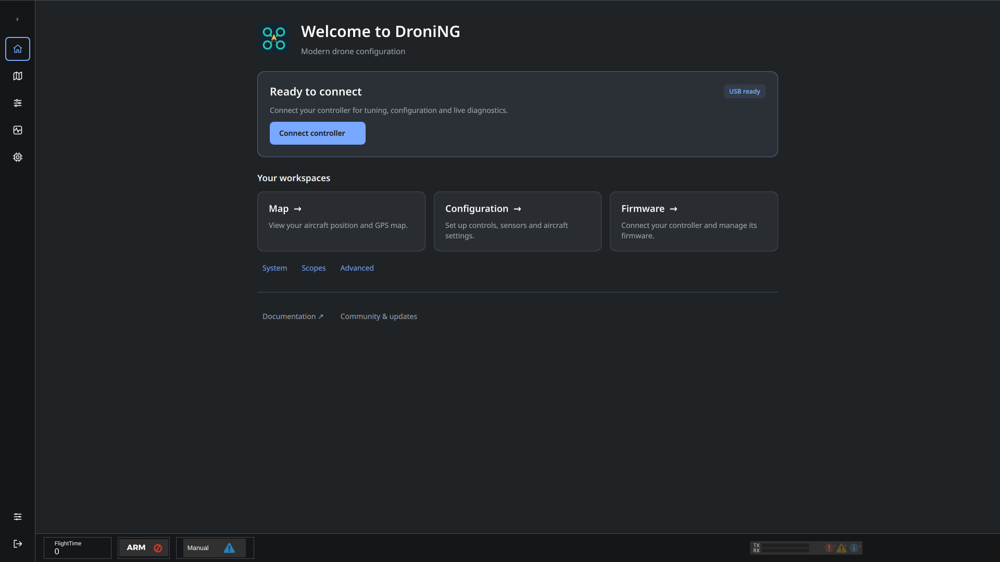

# droniNG help

Set up your flight controller from **Firmware**, then use **Configuration** to configure the aircraft, receiver, outputs and sensors.

## Start here

1. [Connect a controller and install firmware](OnlineHelp:-Uploader-Plugin).
2. [Configure hardware ports](OnlineHelp:-Hardware-Settings).
3. [Select your vehicle and assign motors](OnlineHelp:-Vehicle-configuration).
4. [Configure the receiver](OnlineHelp:-Input-Configuration).
5. [Check outputs](OnlineHelp:-Output-Configuration) and [calibrate sensors](OnlineHelp:-Attitude).

## Configuration

- [Saving changes and switching pages](Saving-changes)
- [Stabilization](OnlineHelp:-Stabilization-Panel)
- [Modules](OnlineHelp:-Modules)
- [Autotune](OnlineHelp:-Autotune)
- [Camera stabilization](OnlineHelp:-Camera-Stabilization-Configuration)
- [Transmitter PID tuning](OnlineHelp:-TxPID-Module)
- [Controller settings import and export](OnlineHelp:-UAV-Settings-import-export)
- [Application settings import and export](OnlineHelp:-Import-Export)

Screenshots show the current Linux UI, including full-screen application captures and previews of board-specific settings and module tabs. Available controls depend on the connected controller, installed firmware and enabled modules. These examples illustrate the layout; they do not show settings ready for flight.
