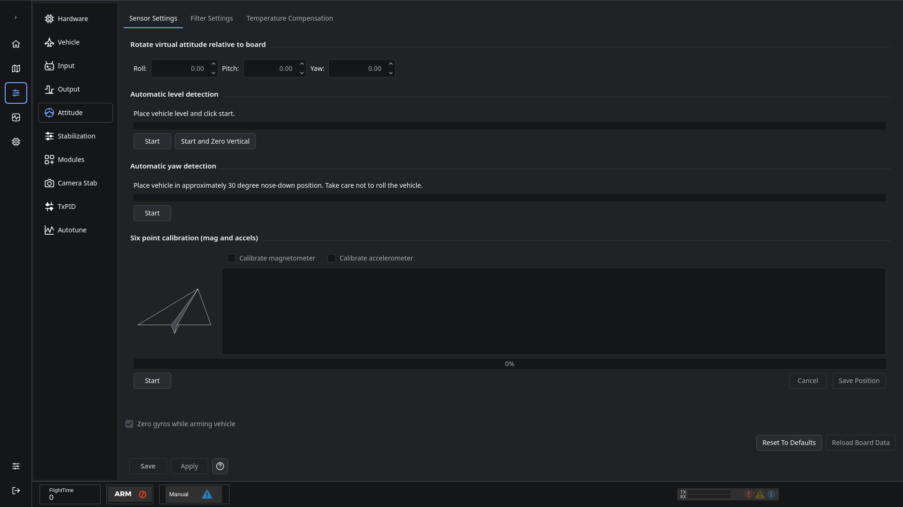
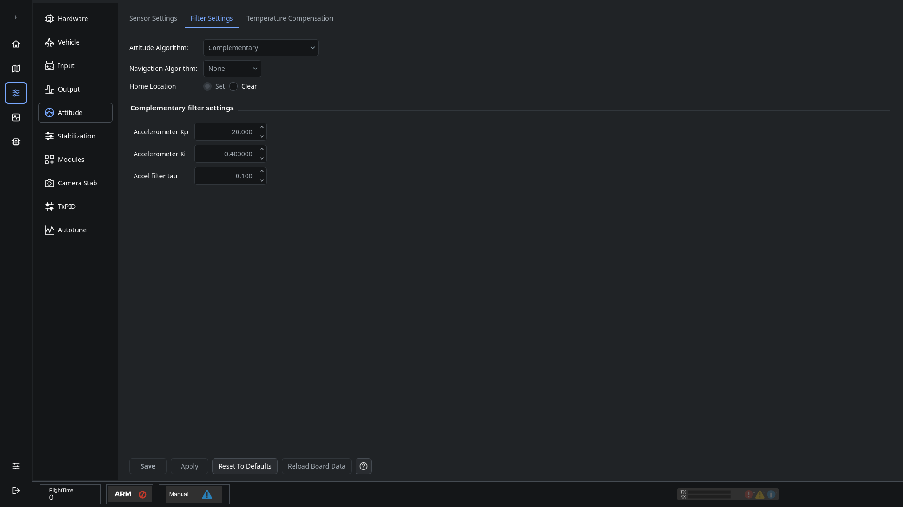

# Attitude and sensor calibration

Open **Configuration → Attitude** to configure board orientation and calibrate supported sensors. Available tabs depend on the controller's capabilities.

## Board orientation and level

Set the board rotation to match how it is mounted in the aircraft. Verify the displayed attitude follows actual aircraft movement before flight.

For level detection, place the aircraft level and still, start calibration and wait for collection to finish. Save the result. Automatic yaw detection uses the orientation shown in its instructions; do not substitute a different pose.

## Six-point calibration

1. Select the supported sensors you want to calibrate and start the procedure.
2. Put the aircraft in the position shown by the diagram.
3. Save that position and keep it still until data collection finishes.
4. Repeat for all six positions.
5. Click **Save** after the procedure completes.

Calibrate a magnetometer in the installed aircraft configuration, away from metal and magnetic interference. The six positions establish sensor scale and bias; they are separate from setting the level angle.

## Filter Settings

Select attitude and navigation algorithms supported by the connected firmware and sensors. The filter parameters and Home Location controls are on this tab; read each parameter's tooltip before changing its value.

## Temperature Compensation

Follow the Temperature Compensation tab's collection and acceptance states when supported. Keep the aircraft still during measurements, then accept and save a completed result.

See [Saving changes](Saving-changes).

Adapted from the [dRonin attitude help](https://github.com/d-ronin/dRonin/wiki/OnlineHelp:-Attitude).
