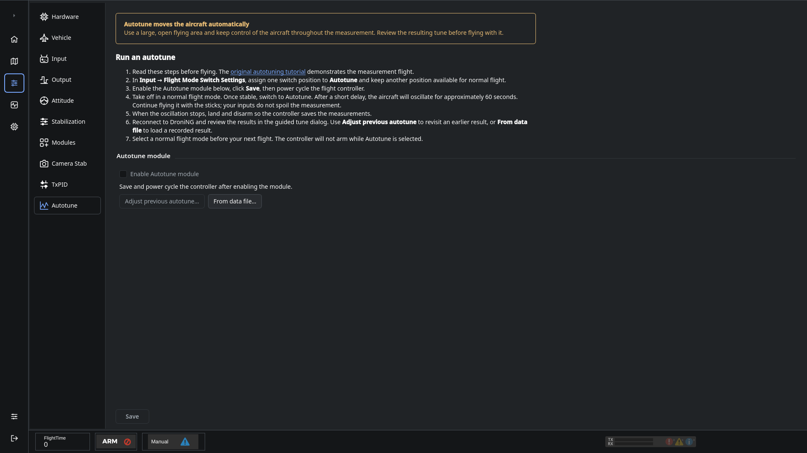

# Autotune

Autotune measures the aircraft's response while it is flying, then guides you through calculating and reviewing a tune.

**Autotune moves the aircraft automatically.** Use a large, open area and keep control of the aircraft throughout the measurement. Review the results before flying with a new tune.

1. In **Input → Flight Mode Switch Settings**, assign one position to Autotune and keep another position for normal flight.
2. Enable the Autotune module, click **Save**, and power cycle the controller.
3. Take off in a normal flight mode. When stable, select Autotune.
4. After a short delay, the aircraft oscillates for approximately 60 seconds. Continue to fly it with the sticks; pilot inputs do not spoil the measurement.
5. When the oscillation ends, land and disarm so the measured properties are stored.
6. Reconnect to droniNG and review the results in the guided dialog. Apply and save a tune only after reviewing the result.
7. Select a normal flight mode before the next flight. The controller will not arm while Autotune is selected.

Use **Adjust previous autotune** to revisit a stored result or **From data file** to load one from a recording.

These instructions match the Autotune page. The [original measurement-flight tutorial](https://vimeo.com/104806460) provides historical context; its older application UI differs from current droniNG.
