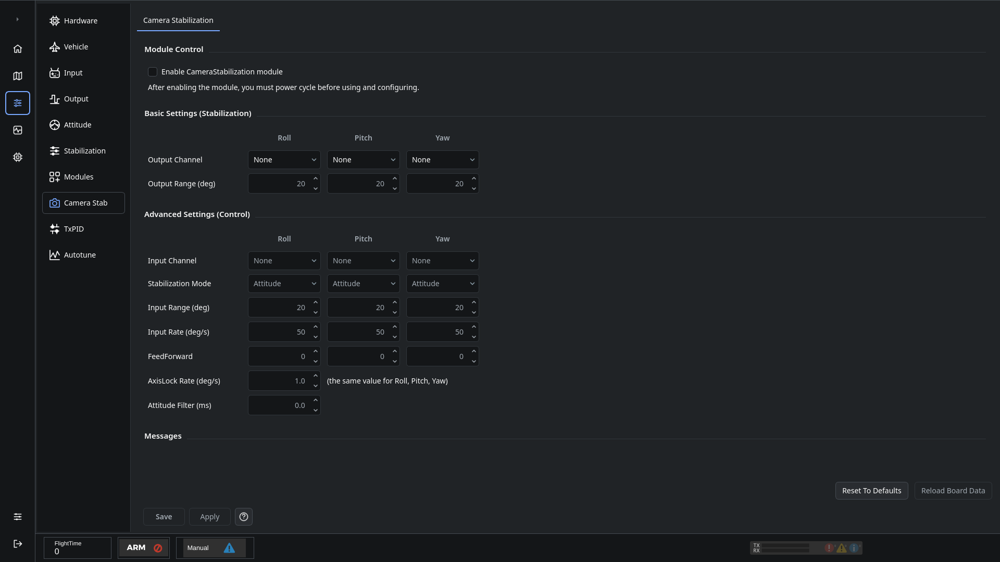

# Camera stabilization

Use **Configuration → Camera Stab** to configure supported servo gimbals.

1. Configure any transmitter accessory inputs needed for manual camera control on Input.
2. On Output, select servo-compatible bank rates and set safe travel limits and neutral positions. Use the servo's specifications; do not assume a high update rate is supported.
3. Enable Camera Stabilization, click **Save**, and restart the controller.
4. Select the gimbal type and assign the Roll, Pitch and Yaw output channels, or Servo 1/Servo 2 for a mixed roll/pitch gimbal.
5. Set the output range and verify the gimbal counters aircraft movement without binding.
6. Configure manual input channels and response settings as needed, then save.

## Control settings

| Setting | Meaning |
| --- | --- |
| Output channel | Physical output connected to that servo. Avoid channels already assigned to another function. |
| Output range | Aircraft rotation corresponding to the servo's travel from neutral to its limit. |
| Input channel | Optional accessory input used for manual control. |
| Attitude mode | Manual input requests an angular offset while the camera stabilizes the axis. |
| AxisLock mode | Manual input requests movement while the controller holds the angle when centered. |
| Input range / rate | Limits manual angle or rotation-rate commands. |
| Response time | Smooths changes in manual input. |

For mixed gimbals, verify both servos' roll and pitch directions, then recenter and check travel again. Advanced object settings can include separate servo pitch reversal; use the object browser only when needed for the installed gimbal.

See [Output](OnlineHelp:-Output-Configuration), [Input](OnlineHelp:-Input-Configuration) and [Saving changes](Saving-changes).

Adapted from the [dRonin camera stabilization help](https://github.com/d-ronin/dRonin/wiki/OnlineHelp:-Camera-Stabilization-Configuration), with current screenshots and device-specific servo-rate guidance.
