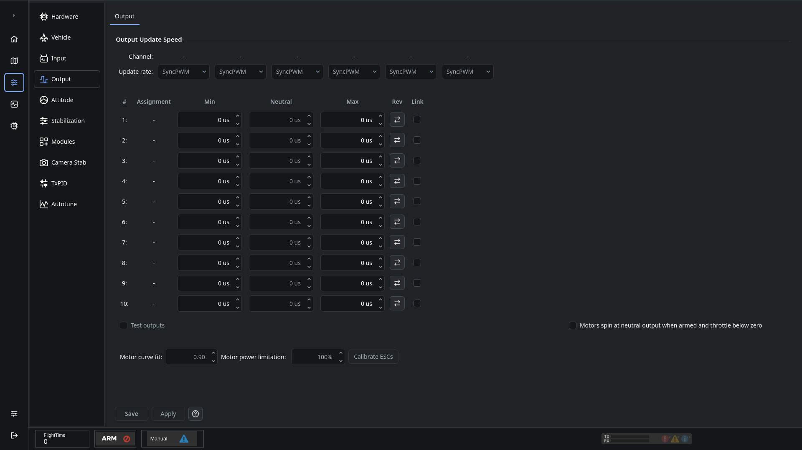

# ESC and servo refresh rates

Output protocol and refresh rate must match the installed actuator and the controller's supported output bank.

- **PWM:** Commands are pulse widths. Set the endpoints and a repetition rate supported by the ESC or servo.
- **OneShot / MultiShot:** Shorter pulse protocols require their matching timing ranges. Ordinary PWM endpoints are not interchangeable with these protocols.
- **DShot:** Commands are digital. Select a DShot mode supported by the controller output and ESC; ordinary PWM endpoint calibration does not apply.
- **Servos:** Use the servo's specified pulse range and update rate. Do not apply a motor protocol or an unsupported high refresh rate to a servo.

Several output channels can share a timer bank. Check every actuator on that bank before changing its mode or rate. Save the configuration and perform any required restart before checking the result.

See [Output configuration](OnlineHelp:-Output-Configuration).

Replaces the [dRonin ESC refresh-rate stub](https://github.com/d-ronin/dRonin/wiki/OnlineHelp:-ESC-Refresh-Rate). Supported choices come from the connected controller and firmware, rather than a universal rate recommendation.
