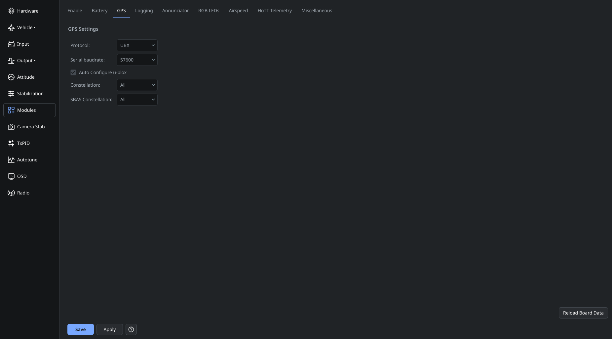

# GPS

GPS requires a compatible receiver, a configured controller port and running firmware support.

1. Wire the receiver using the controller and GPS pinouts. For UART connections, GPS TX goes to controller RX, GPS RX goes to controller TX, and both share ground. Connect both data directions when using receiver autoconfiguration.
2. In **Hardware**, assign the connected port to GPS. Save and restart the controller.
3. Open **Modules → GPS** and select the protocol and serial speed supported by the receiver. The page offers NMEA and u-blox settings where supported.
4. For a compatible u-blox receiver, configure the autoconfiguration option as needed. Autoconfiguration can configure the receiver each time the controller starts.
5. Save, restart if required, and check that GPS data arrives. Test satellite reception outdoors with a clear view of the sky.

A receiving GPS with no position fix is different from an absent or unresponsive receiver. Check the port, wiring and baud rate when no data arrives; check antenna placement and reception when data arrives without a fix.

Use the peripheral's specified power supply and logic levels. A controller's auxiliary 3.3 V output may not have enough current for a GPS receiver.

Map waypoint controls depend on the current controller's GPS capability and required navigation modules. Follow the Map page's enable action when offered; GPS wiring alone does not configure a flight plan.

See [Hardware](OnlineHelp:-Hardware-Settings) and [Saving changes](Saving-changes).

Adapted from the [dRonin GPS help](https://github.com/d-ronin/dRonin/wiki/OnlineHelp:-GPS). Vendor-tool screenshots and historical receiver-specific defaults are omitted from this application guide.
