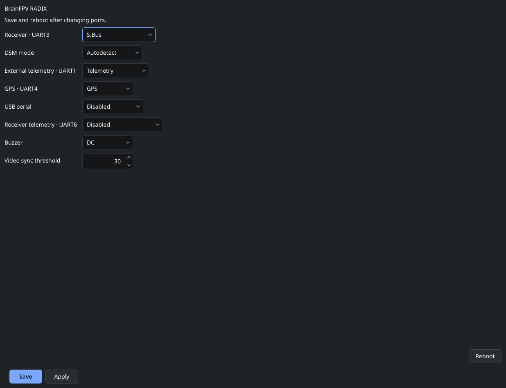

# Hardware settings

The Hardware page shows the configuration supported by the connected flight controller. The application detects the board and loads its board-specific form; available ports and options differ between targets.

1. Connect the controller from **Firmware** and wait for live data.
2. Open **Configuration → Hardware**.
3. Assign each port to the connected device: for example a supported receiver protocol, GPS, telemetry or a serial bridge.
4. Save the settings, then restart the controller for port changes to take effect.
5. Continue with the corresponding [receiver](OnlineHelp:-Input-Configuration), [GPS](OnlineHelp:-GPS) or [module](OnlineHelp:-Modules) setup.

Choose ports by the actual board's wiring and electrical capabilities. A labeled UART does not guarantee signal inversion, sensor power, or every peripheral function. Verify the board and peripheral pinouts before connecting them.

If the page says no recognized board was detected, return to Firmware and check connection status and the detected board model. A USB device appearing in the list does not by itself establish a working telemetry connection.

See [Saving changes](Saving-changes).

Adapted from the [dRonin hardware help](https://github.com/d-ronin/dRonin/wiki/OnlineHelp:-Hardware-Settings), with a current board-specific screenshot.
