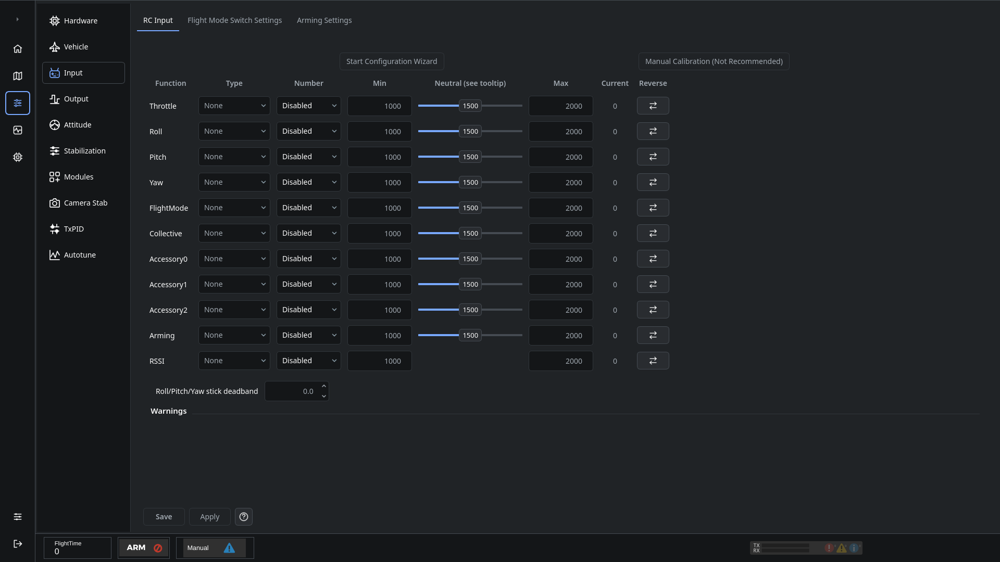

# Input configuration

Configure the receiver port in [Hardware](OnlineHelp:-Hardware-Settings) before assigning input channels. Save and restart the controller after changing the port function.

## Receiver channels

Remove propellers before setup. Power the receiver, turn on the transmitter, and use **Start Configuration Wizard** to identify and calibrate the controls. Some receivers need external power; a USB connection alone may not power them.

Each row maps an aircraft control to a receiver group/channel and records its minimum, neutral and maximum signal values. Move the corresponding stick or switch and check the live value. Use the reversal control when the direction is wrong, then verify it again.

**Throttle neutral is the low-throttle threshold, not the midpoint of the stick.** Follow the wizard's throttle instructions and verify the low endpoint.

## Flight Mode Switch Settings

Assign the flight-mode switch positions and choose the mode for each position. Confirm the displayed position follows the transmitter switch. Keep a normal flight mode available when configuring Autotune.

## Arming Settings

Choose an arming method you can operate reliably. Check it with propellers removed. A newly configured controller may remain disarmed until arming and the required inputs are set correctly.

Click **Save** to store the page's settings. See [Saving changes](Saving-changes) and [Output configuration](OnlineHelp:-Output-Configuration).

Adapted from the [dRonin input help](https://github.com/d-ronin/dRonin/wiki/OnlineHelp:-Input-Configuration).
