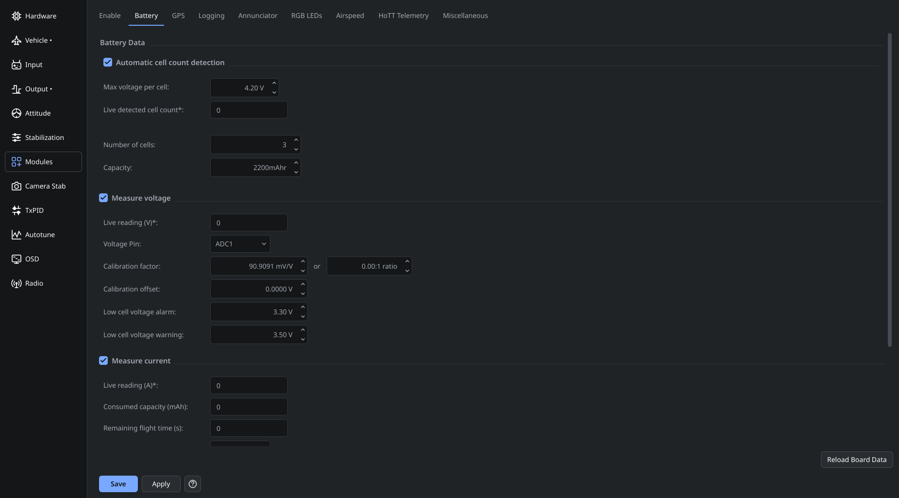

# Battery monitoring

Enable the Battery module, save and restart the controller, then open **Modules → Battery**.

1. Select the voltage and/or current input pins that are actually wired to the sensor. Some boards also need an ADC-capable port configuration in Hardware.
2. Set the battery cell count and capacity.
3. Enter the voltage/current calibration values for the installed sensor and board.
4. Compare reported voltage with a meter, and calibrate the readings before relying on alarms or consumed-capacity estimates.
5. Save the result.

**Connect sensors within the board's documented ADC limits.** Do not connect flight-battery voltage directly to an ADC pin. Boards with built-in voltage/current sensing may already contain the necessary divider and amplifier; an external sensor has different calibration requirements.

Old calibration tables are not universal board defaults. Use the actual hardware's specifications and verify measurements. If an input is unused, leave its measurement disabled rather than configuring an unwired pin.

See [Hardware](OnlineHelp:-Hardware-Settings), [Modules](OnlineHelp:-Modules) and [Saving changes](Saving-changes).

Adapted from the [dRonin battery help](https://github.com/d-ronin/dRonin/wiki/OnlineHelp:-Modules-Battery). Model-specific historical calibration tables have been removed because they were incomplete and do not describe every board revision.
