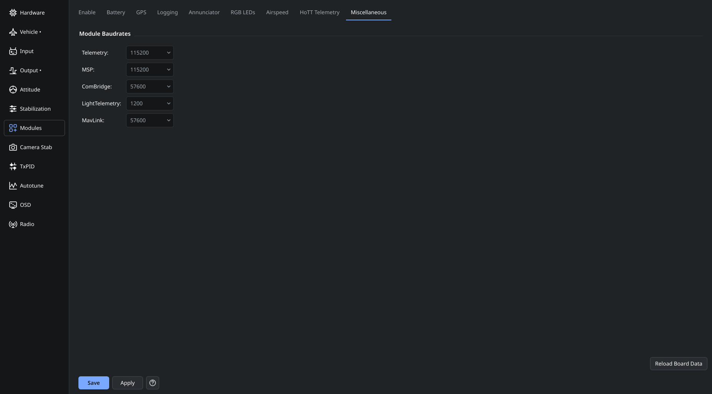

# Miscellaneous module settings

The Miscellaneous tab contains additional settings for optional controller functions, including serial bridge settings when supported.

Configure only the functions used by your hardware. For a serial bridge, assign the corresponding ports in Hardware and choose a baud rate matching the peripheral. Saving a baud rate does not assign the port function.

Read each field's tooltip for the current firmware's meaning and units. Save changes and restart the controller when required by the affected function.

See [Modules](OnlineHelp:-Modules), [Hardware](OnlineHelp:-Hardware-Settings) and [Saving changes](Saving-changes).

Replaces the screenshot-only [dRonin miscellaneous help](https://github.com/d-ronin/dRonin/wiki/OnlineHelp:-Modules-Misc).
