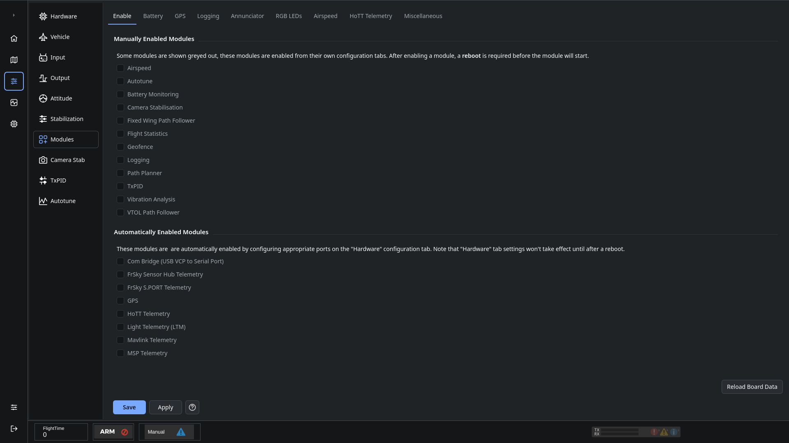

# Modules

Use **Configuration → Modules** to enable optional functions and configure their settings. Availability depends on the controller and firmware.

1. Enable the required function on the Enable tab.
2. Click **Save**, then restart the controller when the function requires it.
3. Return to Modules and configure the function's tab. A disabled tab can mean the module is not running or is unavailable in that firmware.
4. Save the configuration and check the resulting telemetry or peripheral behavior.

The page includes settings for:

- [Battery monitoring](OnlineHelp:-Modules-Battery)
- [GPS](OnlineHelp:-GPS)
- Logging
- Annunciator outputs
- RGB LEDs
- Airspeed sensors
- HoTT telemetry
- [Miscellaneous settings](OnlineHelp:-Modules-Misc)

Some functions also need a port assignment in [Hardware](OnlineHelp:-Hardware-Settings). A module checkbox alone does not configure its wiring or port.

Autotune, Camera Stab and TxPID also have dedicated configuration pages. See [Saving changes](Saving-changes) for draft, Apply and Save behavior.

Adapted from the [dRonin modules help](https://github.com/d-ronin/dRonin/wiki/OnlineHelp:-Modules).
