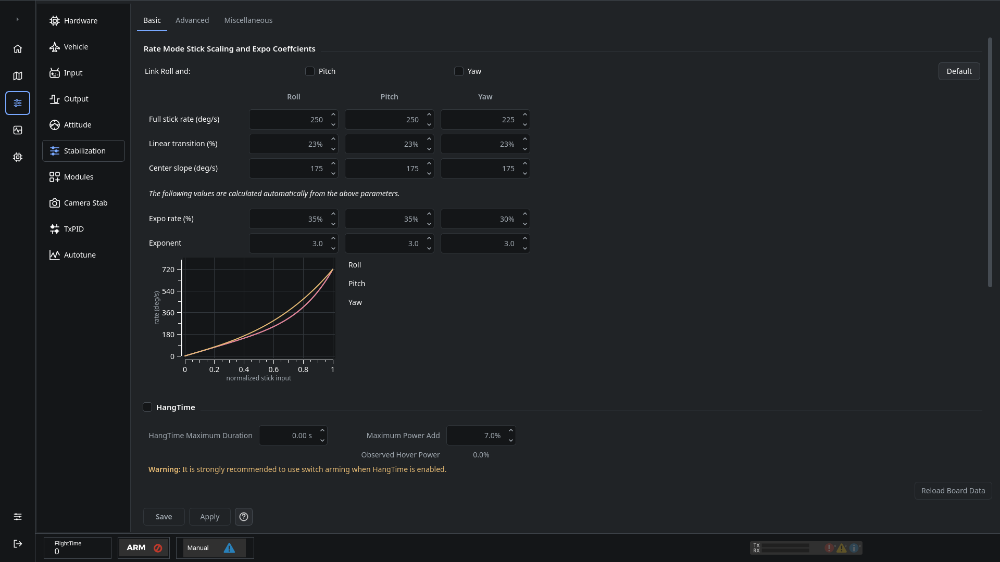
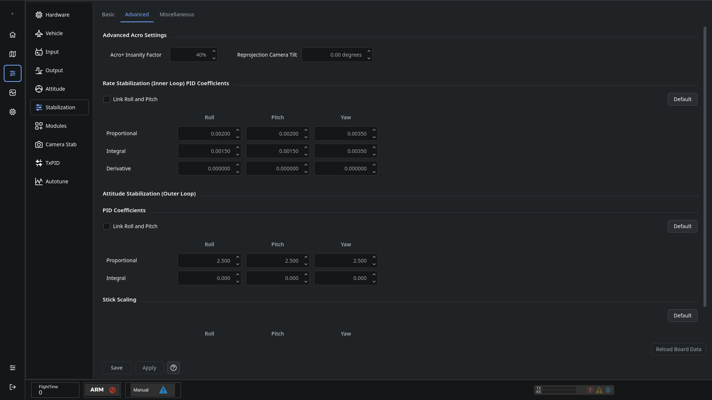

# Stabilization

Use **Configuration → Stabilization** to adjust stick response, control-loop gains and additional stabilization settings. Roll, Pitch and Yaw use aligned columns throughout the page.

## Basic

**Full stick rate** sets the requested rotation rate at full stick for rate-based modes. **Linear transition** and **Center slope** shape the response around the center. Calculated expo fields and the graph show the resulting curve.

The link controls copy selected Roll adjustments to Pitch and/or Yaw. Check whether linking is enabled before changing a value.

## Advanced

The **inner rate loop** controls rotation rate. The **outer attitude loop** converts an angle error into the requested rate for attitude control.

| Term | Effect |
| --- | --- |
| Proportional (P) | Responds to the current error. Excessive gain can cause oscillation. |
| Integral (I) | Compensates for persistent error. The integral limit bounds its contribution. |
| Derivative (D) | Responds to changes in error and can damp movement. It is sensitive to noise and vibration. |

Stick angle limits apply to attitude commands; rate limits govern the requested rotation rate. Read each field's tooltip for its units and scope. Values shown in different editors may use different scales.

## Miscellaneous

Additional options depend on the installed firmware. Change one setting at a time and verify the result. Use [Autotune](OnlineHelp:-Autotune) when supported rather than copying a tune from another aircraft.

See [Saving changes](Saving-changes).

Adapted from the [dRonin stabilization help](https://github.com/d-ronin/dRonin/wiki/OnlineHelp:-Stabilization-Panel). This revision corrects the old page's inconsistent inner/outer loop naming and replaces its screenshots.
