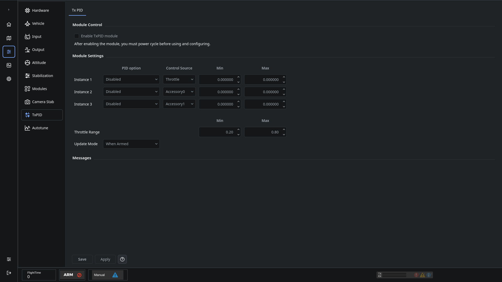

# Transmitter PID tuning

TxPID maps transmitter accessory inputs to supported tuning parameters. Use **Configuration → TxPID** to select the mapping and value range.

1. Configure and verify the accessory controls on Input.
2. Enable the TxPID module, save and restart the controller as required.
3. Choose the update mode, input control, tuning parameter and minimum/maximum for each mapping.
4. Use a narrow, understood adjustment range and verify which parameter changes before flying.
5. Save the configuration and use the selected transmitter input to adjust the parameter.

A transmitter tuning input changes controller behavior while active. Check its position and configured range before flight. Do not assign a control that also performs another critical function.

See [Input](OnlineHelp:-Input-Configuration), [Stabilization](OnlineHelp:-Stabilization-Panel) and [Saving changes](Saving-changes).

Replaces the [dRonin TxPID help stub](https://github.com/d-ronin/dRonin/wiki/OnlineHelp:-TxPID-Module).
