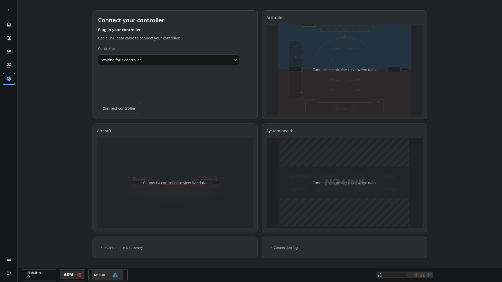

# Firmware and controller connection

Open **Firmware** from Home or the sidebar. The page shows controller connection status, detected firmware and the available next action.

## Connect

1. Complete the Home page's Linux USB-access setup if it is offered.
2. Connect the controller by USB, choose it from the Controller list and click **Connect controller**.
3. Wait for board and firmware detection to finish. Check the detected physical board before installing firmware.
4. Follow the page's action: set up the controller, open configuration, or install compatible firmware when it is offered.

## Install

Remove propellers. Installation replaces firmware and can replace settings; export settings first when they need to be retained.

Use the firmware maintenance entry to select a supported board and begin installation. Follow the displayed BOOT/DFU or native bootloader instructions for that board. Keep the controller connected until writing and verification complete, then follow the startup step and wait for live data.

The application checks the selected image and detected hardware. A USB connection, completed write or bootloader response is not the same as receiving flight telemetry; the page reports those states separately.

## Recovery

Read the inline status and use the recovery action offered for that state. If the controller does not start, follow the displayed power-cycle and reconnection instructions. Expand the recovery/log details when diagnosis is needed.

Firmware maintenance also exposes native bootloader recovery where supported. The old uploader's Halt/Rescue controls belong to that recovery workflow; they are not the normal starting point for a new connection.

Continue with [Hardware](OnlineHelp:-Hardware-Settings) and [Vehicle](OnlineHelp:-Vehicle-configuration).

Replaces the older [dRonin uploader help](https://github.com/d-ronin/dRonin/wiki/OnlineHelp:-Uploader-Plugin) with the current Firmware workflow.
