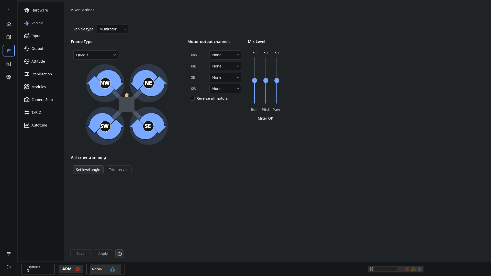

# Vehicle configuration

Choose **Configuration → Vehicle**, then select the aircraft type. The form changes to show the controls for that type.

## Multirotor

1. Select the frame that matches your aircraft. Read the drawing from above, with the front indicated by the forward arrow.
2. In **Motor output channels**, assign a controller output to each motor position shown in the drawing. For Quad X, NW/NE are the front left/right motors and SW/SE are the rear left/right motors.
3. Follow the rotation arrows. **Reverse all motors** changes the expected rotation pattern; the drawing updates with it.
4. A tricopter also shows a **Yaw servo** output. Unused outputs are hidden for frames with fewer motors.
5. Click **Save**, then verify the assignments and actual rotation on [Output](OnlineHelp:-Output-Configuration) with propellers removed.

The channel list sits beside the drawing. It maps motor positions to physical controller outputs; it is not a second set of motors. Mix Level controls tune the roll, pitch and yaw contribution to the mixer.

## Other vehicle types

Fixed Wing and Ground Vehicle show named motor, control-surface and steering outputs. Helicopter has its own swashplate setup tabs. Use only channels wired to the corresponding actuator.

**Custom** exposes the mixer table and throttle curve for aircraft that need a different mix. Selecting Custom keeps the current mixer as a starting point. Check every output and mixer contribution before powering actuators.

Use **Airframe trimming** for level-angle and servo trim after the basic configuration is correct.

See [Saving changes](Saving-changes).

Adapted for droniNG from the [dRonin vehicle help](https://github.com/d-ronin/dRonin/wiki/OnlineHelp:-Vehicle-configuration), with new screenshots and layout instructions.
