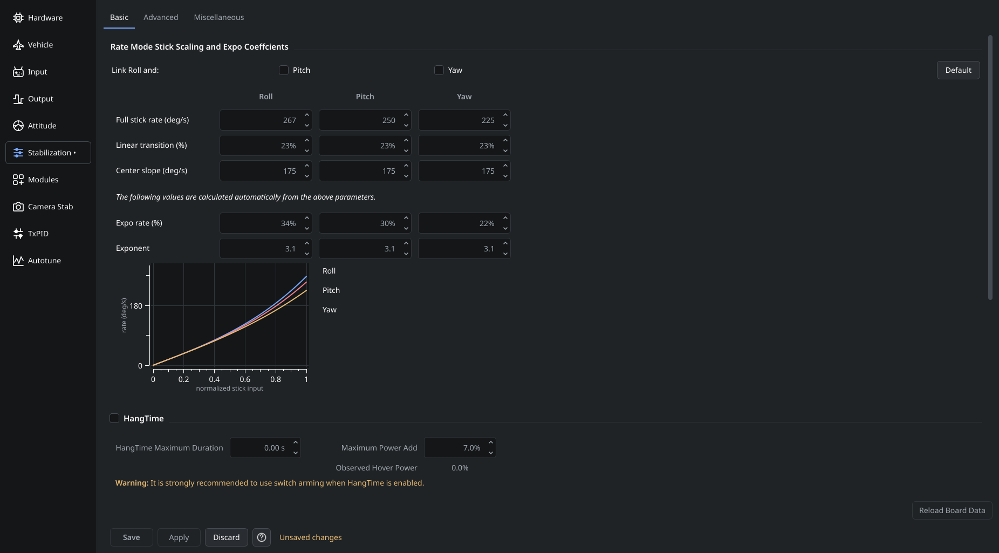

# Saving changes

Configuration pages keep edits while you switch between pages and their tabs. Switching pages does not apply settings to the controller.

The footer shows **Unsaved changes** while the page has a draft. A dot beside its name in the configuration navigation identifies pages with unfinished changes.

| Action | Result |
| --- | --- |
| **Apply** | Sends this page's settings to the controller for the current session. Changes can be lost after a restart. |
| **Save** | Applies this page's settings and stores them permanently on the controller. |
| **Discard** | Replaces this page's draft with the controller settings currently held by the application. It sends no settings to the controller. |

Apply and Save affect the current page, including its subtabs. Drafts on other configuration pages remain separate. After a successful Apply or Save, the draft indicator clears. If an operation fails, inspect its result before continuing.

Drafts last for the current controller session. Save changes you want to keep before disconnecting, reconnecting, closing the application or installing firmware. Hardware-port and module changes can require a controller restart after saving.

Output testing stops when you leave the Output page.
